# Critical path

Generated by `constitution-tooling render` from `tasks/epics/` and `tasks/completed/`. Do not edit by hand; change the epic files and render again.

## Totals

| Active epics | Open points | Out-of-band epics | Out-of-band points | Waves | Widest wave | Longest chain (points) |
| :--- | :--- | :--- | :--- | :--- | :--- | :--- |
| 28 | 445 | 0 | 0 | 21 | 6 | 348 |

## Longest chain

EPIC-DP → EPIC-DQ → EPIC-DT → EPIC-DR → EPIC-DK → EPIC-DL → EPIC-DN → EPIC-DS → EPIC-DG → EPIC-DH → EPIC-DI → EPIC-DJ → EPIC-CB → EPIC-CC → EPIC-CD → EPIC-CI → EPIC-CJ → EPIC-CK → EPIC-CO → EPIC-CP → EPIC-CQ (348 points). Points describe dependency-weighted work, not elapsed time; actual concurrency also depends on resource readiness.

## Waves

An epic joins a wave when every dependency is completed or sits in an earlier wave and it is scope-disjoint from every other epic in the wave. Active out-of-band prerequisites, missing dependencies, and cycles block it and its dependents. A wave of one is a serial segment.

| Wave | Epic | Kind | Open points | Owns | May patch | Depends on |
| :--- | :--- | :--- | :--- | :--- | :--- | :--- |
| 1 | EPIC-DP Bind durable control evidence to certificates | product | 15 | `tools/conformance/harness/storage-resource.ts`, `tools/conformance/harness/run.ts`, `tools/conformance/harness/test/server-clock-verification.test.ts`, `tools/conformance/harness/test/durable-claims.test.ts`, `tools/scripts/verify-kernel.ts`, `tools/scripts/verify.ts`, `tools/conformance/certification`, `tools/conformance/meta-conformance`, `tools/schemas`, `tools/scripts/conformance`, `tools/scripts/lib/conformance-contract.ts`, `spec/kernel/authority-packet.json`, `reports/compatibility`, `tools/scripts/compatibility-report.ts` | — | — |
| 2 | EPIC-DQ Move TypeScript and Rust to canonical kernel plans | product | 21 | `spec/kernel/authority-packet.json`, `spec/kernel/legacy/authority-packet.json`, `spec/conformance/kernel`, `tools/schemas`, `tools/conformance/adapter-protocol`, `tools/conformance/harness`, `tools/conformance/plan-compiler`, `tools/conformance/certification`, `tools/conformance/meta-conformance`, `tools/scripts/authority-guardrails`, `tools/scripts/compatibility-report.ts`, `typescript/kernel/protocol`, `typescript/kernel/conformance-adapter`, `typescript/kernel/testkit`, `rust/kernel`, `rust/kernel-conformance-adapter`, `go/kernel-conformance-adapter/adapter.json`, `python/kernel-conformance-adapter/adapter.json`, `dart/kernel-conformance-adapter/adapter.json`, `reports/compatibility`, `tools/scripts/portability-gate.ts`, `.constitution/reports/epic-al-portability-inventory.json`, `.constitution/reports/epic-al-portable-surface-conformance-gap-inventory.md`, `tools/scripts/conformance/generate-kernel-plans.ts`, `.changeset/kernel-dq-canonical-plans.md` | — | EPIC-DP |
| 3 | EPIC-DT Certify durable backends on core rules | product | 5 | `spec/conformance/kernel`, `typescript/kernel/backends`, `typescript/kernel/runtime`, `typescript/kernel/testkit`, `typescript/kernel/conformance-adapter`, `tools/conformance/meta-conformance`, `tools/conformance/harness/test`, `reports/compatibility`, `typescript/kernel/certification-sqlite`, `typescript/kernel/certification-postgres`, `tools/conformance/certification` | — | EPIC-DQ |
| 4 | EPIC-DR Close kernel.memory control gaps by rule | product | 25 | `spec/conformance/kernel`, `typescript/kernel/testkit`, `typescript/kernel/conformance-adapter`, `tools/conformance/meta-conformance`, `tools/conformance/harness/test`, `reports/compatibility` | — | EPIC-DT |
| 5 | EPIC-DK Portable certification core | product | 19 | `tools/conformance/harness`, `tools/conformance/plan-compiler`, `tools/conformance/certification`, `tools/scripts/authority-guardrails/authority-guardrails.ts`, `tools/scripts/conformance/certification-schemas.ts`, `tools/scripts/lib/conformance-contract.ts`, `tools/scripts/lib/verification-logs.ts`, `tools/conformance/adapter-protocol`, `tools/conformance/meta-conformance`, `reports/compatibility`, `.constitution/spikes/SPK-KRT-DK001.md` | `.constitution/tech-spec/adrs/ADR-0082-published-runtime-portable-backend-testkit.md` | EPIC-DP, EPIC-DQ, EPIC-DR |
| 6 | EPIC-DL Backend testkit binding and plan families | product | 20 | `typescript/kernel/testkit`, `typescript/kernel/conformance-adapter`, `typescript/kernel/runtime`, `typescript/kernel/protocol`, `typescript/kernel/backends/memory`, `typescript/kernel/backends/shared`, `typescript/kernel/backends/sqlite`, `typescript/kernel/backends/postgres`, `typescript/kernel/certification`, `typescript/kernel/certification-sqlite`, `typescript/kernel/certification-postgres`, `spec/conformance/kernel`, `spec/kernel/authority-packet.json`, `tools/conformance/harness`, `tools/conformance/plan-compiler`, `tools/conformance/certification`, `tools/conformance/meta-conformance`, `tools/conformance/adapter-protocol`, `reports/compatibility`, `.changeset/kernel-dl-backend-testkit-binding.md` | `.constitution/tech-spec/adrs/ADR-0082-published-runtime-portable-backend-testkit.md`, `.constitution/tech-spec/contracts/backend-testkit.meta.yaml` | EPIC-DP, EPIC-DQ, EPIC-DR, EPIC-DK |
| 7 | EPIC-DN Publish the runtime-portable backend testkit | product | 24 | `tools/scripts/publish-registry.ts`, `typescript/kernel/testkit`, `typescript/kernel/backends/memory`, `typescript/kernel/backends/sqlite`, `typescript/kernel/backends/postgres`, `typescript/kernel/backends/shared`, `typescript/kernel/certification`, `typescript/kernel/certification-sqlite`, `typescript/kernel/certification-postgres`, `typescript/kernel/conformance-adapter`, `typescript/runtime/package.json`, `typescript/runtime/test/durable-reads.scope-isolation.test.ts`, `typescript/runtime/tsconfig.typecheck.json`, `typescript/runners/react/tsconfig.typecheck.json`, `typescript/sdk/tsconfig.typecheck.json`, `typescript/providers/certification/tsconfig.typecheck.json`, `typescript/providers/bridge-ai-sdk/tsconfig.typecheck.json`, `tsconfig.base.json`, `tools/scripts/portability-check.ts`, `tools/scripts/typecheck-source-aliases.test.ts`, `tools/scripts/backend-testkit-consumer-smoke.ts`, `tools/conformance/harness`, `tools/conformance/certification`, `tools/conformance/meta-conformance`, `tools/conformance/adapter-protocol`, `tools/schemas/certification-evidence.schema.json`, `tools/scripts/conformance/certification-schema-examples.ts`, `tools/scripts/conformance/certification-schemas.test.ts`, `reports/compatibility`, `docs/guides/add-a-kernel-backend.md`, `.changeset/conformance-handle-barriers.md`, `.changeset/kernel-dn-publish-backend-testkit.md`, `package.json`, `bun.lock` | `.constitution/tech-spec/adrs/ADR-0082-published-runtime-portable-backend-testkit.md`, `.constitution/tech-spec/contracts/backend-testkit.meta.yaml` | EPIC-DL |
| 8 | EPIC-DS Match Rust memory controls to its implementation | product | 15 | `rust/kernel`, `rust/kernel-conformance-adapter`, `tools/conformance/meta-conformance`, `tools/conformance/certification`, `reports/compatibility`, `tools/scripts/compatibility-report.ts` | — | EPIC-DR, EPIC-DN |
| 9 | EPIC-DG Certify the Go kernel on the kernel catalog | product | 18 | `go/kernel`, `go/kernel-conformance-adapter`, `go/kernel-certification`, `reports/compatibility/compatibility-matrix.json`, `reports/compatibility/evidence/certification-harness.kernel-go-certification.json`, `tools/conformance/meta-conformance/negative-control-config.ts`, `tools/conformance/certification/provenance.ts`, `tools/conformance/certification/certified-projects.json`, `spec/kernel/legacy/authority-packet.json` | — | EPIC-DS |
| 10 | EPIC-DH Certify the Python kernel on the kernel catalog | product | 18 | `python/kernel`, `python/kernel-conformance-adapter`, `python/kernel-certification`, `reports/compatibility/compatibility-matrix.json`, `reports/compatibility/evidence/certification-harness.kernel-python-certification.json`, `tools/conformance/meta-conformance/negative-control-config.ts`, `tools/conformance/certification/provenance.ts`, `tools/conformance/certification/certified-projects.json`, `spec/kernel/legacy/authority-packet.json` | — | EPIC-DG |
| 11 | EPIC-DI Certify the Dart kernel on the kernel catalog | product | 18 | `dart/kernel`, `dart/kernel-conformance-adapter`, `dart/kernel-certification`, `reports/compatibility/compatibility-matrix.json`, `reports/compatibility/evidence/certification-harness.kernel-dart-certification.json`, `tools/conformance/meta-conformance/negative-control-config.ts`, `tools/conformance/certification/provenance.ts`, `tools/conformance/certification/certified-projects.json`, `spec/kernel/legacy/authority-packet.json` | — | EPIC-DH |
| 12 | EPIC-DJ Retire legacy kernel plans and composite operations | product | 5 | `spec/conformance/kernel`, `spec/kernel/authority-packet.json`, `spec/kernel/legacy/authority-packet.json`, `tools/conformance/plan-compiler`, `tools/conformance/certification`, `typescript/kernel/conformance-adapter`, `rust/kernel-conformance-adapter`, `go/kernel-conformance-adapter`, `python/kernel-conformance-adapter`, `dart/kernel-conformance-adapter`, `reports/compatibility`, `.constitution/tech-spec/contracts/kernel-legacy-packet.meta.yaml`, `.constitution/tech-spec/guidelines.md`, `tools/scripts/portability-gate.ts`, `.constitution/reports/epic-al-portability-inventory.json`, `.constitution/reports/epic-al-portable-surface-conformance-gap-inventory.md`, `tools/scripts/conformance/generate-kernel-plans.ts` | `.constitution/tech-spec/contracts/kernel-legacy-packet.meta.yaml`, `.constitution/tech-spec/guidelines.md` | EPIC-DG, EPIC-DH, EPIC-DI |
| 13 | EPIC-CB Retire Biome after all directory gates | tooling | 14 | `package.json`, `bun.lock`, `biome.jsonc`, `nx.json`, `.github/dependabot.yml`, `devenv.nix`, `oxlint.config.ts`, `oxfmt.config.ts`, `typescript`, `spec`, `tools`, `reports/compatibility/project.json`, `docs/guides/add-a-driver.md`, `.constitution/tech-spec/stack.yaml`, `.git-blame-ignore-revs`, `.changeset/toolchain-cb-biome-retirement.md` | `.constitution/tech-spec/stack.yaml` | EPIC-DJ, EPIC-DN |
| 14 | EPIC-CC Bazel shared toolchain bootstrap | tooling | 26 | `MODULE.bazel`, `MODULE.bazel.lock`, `.bazelversion`, `.bazelrc`, `.bazelignore`, `devenv.nix`, `devenv.lock`, `.gitignore`, `user.bazelrc`, `go.work`, `tools/bazel/toolchain-sync.ts`, `tools/bazel/toolchain-sync.test.ts`, `tools/bazel/toolchain-sync.bzl`, `tools/bazel/BUILD.bazel`, `.constitution/tech-spec/stack.yaml`, `go/kernel/BUILD.bazel`, `go/kernel-conformance-adapter/BUILD.bazel`, `go/kernel-certification/BUILD.bazel`, `tools/bazel/python-requirements.txt` | `.constitution/tech-spec/stack.yaml` | EPIC-CB |
| 15 | EPIC-CD Staged Bun workspace pilot and CI sandbox gate | tooling | 24 | `tools/bazel/bun-workspace.bzl`, `tools/bazel/ts-package.bzl`, `tools/bazel/ts-runner.sh`, `typescript/core/BUILD.bazel`, `typescript/kernel/protocol/BUILD.bazel`, `typescript/kernel/runtime/BUILD.bazel`, `.github/workflows/ci.yml`, `MODULE.bazel`, `MODULE.bazel.lock`, `.changeset/toolchain-cd-staged-bun-pilot.md` | — | EPIC-CC |
| 15 | EPIC-CE Bazel-native Rust workspace | tooling | 15 | `rust/kernel/BUILD.bazel`, `rust/kernel-grpc-service/BUILD.bazel`, `rust/conformance-adapter/BUILD.bazel`, `rust/kernel-conformance-adapter/BUILD.bazel`, `rust/certification/BUILD.bazel`, `rust/kernel-certification/BUILD.bazel`, `tools/bazel/rust.bzl` | — | EPIC-CC |
| 15 | EPIC-CF Bazel-native Go workspace | tooling | 10 | `go/kernel/BUILD.bazel`, `go/kernel-conformance-adapter/BUILD.bazel`, `go/kernel-certification/BUILD.bazel`, `tools/bazel/go.bzl` | — | EPIC-CC |
| 15 | EPIC-CG Bazel-native Python workspace | tooling | 10 | `python/kernel/BUILD.bazel`, `python/kernel-conformance-adapter/BUILD.bazel`, `python/kernel-certification/BUILD.bazel`, `tools/bazel/python.bzl`, `tools/bazel/python-requirements.txt`, `tools/bazel/python-lock-drift.sh` | — | EPIC-CC |
| 15 | EPIC-CH Dart native-wrapped Bazel exception | tooling | 13 | `dart/kernel/BUILD.bazel`, `dart/kernel-conformance-adapter/BUILD.bazel`, `dart/kernel-certification/BUILD.bazel`, `dart/kernel-conformance-adapter/test/protocol_test.dart`, `tools/bazel/dart.bzl`, `tools/bazel/dart-runner.sh` | — | EPIC-CC |
| 15 | EPIC-CL Bazel project identity and discovery | tooling | 15 | `tools/bazel/project-tags.bzl`, `tools/bazel/project-manifest.bzl`, `tools/bazel/projects.json`, `tools/scripts/lib/nx-projects.ts`, `tools/scripts/validate-workspace-test-coverage.ts`, `tools/scripts/lib/regenerate-command-argv.ts`, `tools/scripts/lib/regenerate-command-argv.test.ts` | — | EPIC-CC |
| 16 | EPIC-CI Staged TypeScript dependency layers 0 to 2 | tooling | 10 | `typescript/host/session-client/BUILD.bazel`, `typescript/telemetry/semconv/BUILD.bazel`, `typescript/host/session/BUILD.bazel`, `typescript/providers/provider-api/BUILD.bazel`, `typescript/streaming/core/BUILD.bazel`, `typescript/telemetry/otel/BUILD.bazel`, `typescript/testkit/BUILD.bazel`, `typescript/host/remote-session/BUILD.bazel`, `typescript/kernel/backends/shared/BUILD.bazel`, `typescript/kernel/grpc-client/BUILD.bazel`, `typescript/providers/bridge-ai-sdk/BUILD.bazel`, `typescript/providers/testkit/BUILD.bazel`, `typescript/runners/react/BUILD.bazel`, `typescript/runtime/BUILD.bazel`, `typescript/streaming/agui/BUILD.bazel`, `typescript/streaming/sse/BUILD.bazel`, `.changeset/toolchain-ci-bazel-ts-kernel-runtime.md` | — | EPIC-CD |
| 16 | EPIC-CM Bazel TypeSpec and telemetry freshness | tooling | 13 | `tools/bazel/source-codegen.bzl`, `tools/bazel/source-codegen-runner.sh`, `tools/scripts/codegen.ts`, `tools/scripts/telemetry-codegen.ts`, `tools/generators`, `spec/core`, `spec/providers`, `spec/runners`, `spec/tools`, `spec/host`, `spec/streaming`, `spec/telemetry`, `typescript/telemetry/semconv/src/lib/generated`, `rust/kernel/src/generated/tuvren_runtime_telemetry.rs`, `tools/bazel/source-codegen`, `.changeset/toolchain-cm-bazel-source-codegen.md` | — | EPIC-CL |
| 16 | EPIC-CN Bazel proto and conformance freshness | tooling | 21 | `tools/bazel/interop-codegen.bzl`, `tools/bazel/interop-codegen-runner.sh`, `tools/scripts/conformance`, `tools/scripts/compatibility-report.ts`, `tools/scripts/api-freeze-gate.ts`, `tools/scripts/__snapshots__`, `spec/interop`, `spec/kernel`, `spec/conformance`, `reports/compatibility`, `typescript/kernel/grpc-client/src/lib/generated/kernel-interop`, `tools/bazel/interop-codegen`, `.changeset/toolchain-cn-bazel-interop-codegen.md` | — | EPIC-CL |
| 17 | EPIC-CJ Staged TypeScript dependency layer 3 | tooling | 10 | `typescript/kernel/backends/memory/BUILD.bazel`, `typescript/kernel/backends/postgres/BUILD.bazel`, `typescript/kernel/backends/sqlite/BUILD.bazel`, `typescript/kernel/testkit/BUILD.bazel`, `typescript/certification/BUILD.bazel`, `typescript/sdk/BUILD.bazel`, `typescript/streaming/ws/BUILD.bazel`, `.changeset/toolchain-cj-bazel-ts-host-adapters.md` | — | EPIC-CI |
| 18 | EPIC-CK Staged TypeScript dependency layers 4 to 5 and wrappers | tooling | 10 | `typescript/kernel/testkit/BUILD.bazel`, `typescript/kernel/certification/BUILD.bazel`, `typescript/providers/certification/BUILD.bazel`, `typescript/tools/mcp-client/BUILD.bazel`, `typescript/conformance-adapter/BUILD.bazel`, `typescript/kernel/conformance-adapter/BUILD.bazel`, `typescript/providers/conformance-adapter/BUILD.bazel`, `typescript/host/repl/BUILD.bazel`, `typescript/kernel/certification-sqlite/BUILD.bazel`, `typescript/kernel/certification-postgres/BUILD.bazel`, `typescript/certification-batteries-included/BUILD.bazel`, `.changeset/toolchain-ck-bazel-ts-packages.md` | — | EPIC-CJ |
| 19 | EPIC-CO Bazel external suites and git-aware gates | tooling | 15 | `tools/bazel/service-tests.bzl`, `tools/bazel/service-test-runner.sh`, `tools/bazel/git-gates.bzl`, `tools/conformance`, `tools/scripts/conformance.ts`, `tools/scripts/lib/worktree-guard.ts`, `tools/scripts/changeset-check.ts`, `tools/scripts/changeset-check.test.ts`, `tools/scripts/check.ts`, `tools/scripts/kernel-interop-governance.ts`, `tools/scripts/repl-host-interop-smoke.ts`, `tools/scripts/proving-host-sqlite-pinned.sh`, `BUILD.bazel` | — | EPIC-CE, EPIC-CF, EPIC-CG, EPIC-CH, EPIC-CK, EPIC-CM, EPIC-CN |
| 20 | EPIC-CP Bazel affected selection CI and release rehearsal | tooling | 21 | `tools/bazel/affected-selection`, `tools/scripts/publish-registry.ts`, `tools/scripts/release-check.ts`, `tools/scripts/release-lane.ts`, `.github/workflows/ci.yml`, `.github/workflows/release.yml`, `.github/dependabot.yml`, `package.json`, `bun.lock` | — | EPIC-CO |
| 21 | EPIC-CQ Final Nx removal and owner handoff | tooling | 15 | `nx.json`, `package.json`, `bun.lock`, `tools/run-nx.mjs`, `tools/nx`, `tools/bazel/nx-run.sh`, `tools/bazel/native_binary.bzl`, `tools/bazel/BUILD.bazel`, `tools/scripts/verify.ts`, `tools/scripts/verify-kernel.ts`, `tools/scripts/check.ts`, `tools/scripts/lib/nx-projects.ts`, `.github/workflows/ci.yml`, `CLAUDE.md`, `AGENTS.md`, `BUILD.bazel`, `typescript`, `rust`, `go`, `python`, `dart`, `spec`, `reports/compatibility`, `.constitution/tech-spec/stack.yaml`, `.constitution/tech-spec/guidelines.md`, `.constitution/tech-spec/adrs/ADR-0069-public-release-discipline.md`, `tools/scripts/lib/project-manifest.ts`, `.changeset/toolchain-cq-nx-final-cutover.md` | `.constitution/tech-spec/stack.yaml`, `.constitution/tech-spec/guidelines.md`, `.constitution/tech-spec/adrs/ADR-0069-public-release-discipline.md` | EPIC-CP |

## Build order

```mermaid
flowchart LR
  DP["EPIC-DP Bind durable control evidence to certificates (15)"]
  DQ["EPIC-DQ Move TypeScript and Rust to canonical kernel plans (21)"]
  DT["EPIC-DT Certify durable backends on core rules (5)"]
  DR["EPIC-DR Close kernel.memory control gaps by rule (25)"]
  DK["EPIC-DK Portable certification core (19)"]
  DL["EPIC-DL Backend testkit binding and plan families (20)"]
  DN["EPIC-DN Publish the runtime-portable backend testkit (24)"]
  DS["EPIC-DS Match Rust memory controls to its implementation (15)"]
  DG["EPIC-DG Certify the Go kernel on the kernel catalog (18)"]
  DH["EPIC-DH Certify the Python kernel on the kernel catalog (18)"]
  DI["EPIC-DI Certify the Dart kernel on the kernel catalog (18)"]
  DJ["EPIC-DJ Retire legacy kernel plans and composite operations (5)"]
  CB["EPIC-CB Retire Biome after all directory gates (14)"]
  CC["EPIC-CC Bazel shared toolchain bootstrap (26)"]
  CD["EPIC-CD Staged Bun workspace pilot and CI sandbox gate (24)"]
  CE["EPIC-CE Bazel-native Rust workspace (15)"]
  CF["EPIC-CF Bazel-native Go workspace (10)"]
  CG["EPIC-CG Bazel-native Python workspace (10)"]
  CH["EPIC-CH Dart native-wrapped Bazel exception (13)"]
  CL["EPIC-CL Bazel project identity and discovery (15)"]
  CI["EPIC-CI Staged TypeScript dependency layers 0 to 2 (10)"]
  CM["EPIC-CM Bazel TypeSpec and telemetry freshness (13)"]
  CN["EPIC-CN Bazel proto and conformance freshness (21)"]
  CJ["EPIC-CJ Staged TypeScript dependency layer 3 (10)"]
  CK["EPIC-CK Staged TypeScript dependency layers 4 to 5 and wrappers (10)"]
  CO["EPIC-CO Bazel external suites and git-aware gates (15)"]
  CP["EPIC-CP Bazel affected selection CI and release rehearsal (21)"]
  CQ["EPIC-CQ Final Nx removal and owner handoff (15)"]
  DP --> DQ
  DQ --> DT
  DT --> DR
  DP --> DK
  DQ --> DK
  DR --> DK
  DP --> DL
  DQ --> DL
  DR --> DL
  DK --> DL
  DL --> DN
  DR --> DS
  DN --> DS
  DS --> DG
  DG --> DH
  DH --> DI
  DG --> DJ
  DH --> DJ
  DI --> DJ
  DJ --> CB
  DN --> CB
  CB --> CC
  CC --> CD
  CC --> CE
  CC --> CF
  CC --> CG
  CC --> CH
  CC --> CL
  CD --> CI
  CL --> CM
  CL --> CN
  CI --> CJ
  CJ --> CK
  CE --> CO
  CF --> CO
  CG --> CO
  CH --> CO
  CK --> CO
  CM --> CO
  CN --> CO
  CO --> CP
  CP --> CQ
```

An arrow points from a prerequisite to the epic that depends on it, so it reads in the order work flows, the same direction as the longest chain above.

## Ticket order inside each epic

A dependency-respecting listing, not a chain: `needs` names a ticket's own `depends_on` inside its epic, and a ticket without one has no in-epic dependency. Readiness is epic-level: a ticket finished on an unmerged branch satisfies no other epic's dependency until the containing PR merges.

- **EPIC-DP:** KRT-DP001, KRT-DP002 (needs KRT-DP001), KRT-DP003 (needs KRT-DP002), KRT-DP004 (needs KRT-DP003), KRT-DP005 (needs KRT-DP004)
- **EPIC-DQ:** KRT-DQ001, KRT-DQ002 (needs KRT-DQ001), KRT-DQ003 (needs KRT-DQ002), KRT-DQ004 (needs KRT-DQ003)
- **EPIC-DT:** KRT-DT001
- **EPIC-DR:** KRT-DR006, KRT-DR001 (needs KRT-DR006), KRT-DR002 (needs KRT-DR001), KRT-DR003 (needs KRT-DR002), KRT-DR004 (needs KRT-DR003), KRT-DR005 (needs KRT-DR004)
- **EPIC-DK:** KRT-DK001, KRT-DK002 (needs KRT-DK001), KRT-DK003 (needs KRT-DK002), KRT-DK004 (needs KRT-DK002)
- **EPIC-DL:** KRT-DL001, KRT-DL002 (needs KRT-DL001), KRT-DL003 (needs KRT-DL001), KRT-DL004 (needs KRT-DL003), KRT-DL005 (needs KRT-DL003, KRT-DL004)
- **EPIC-DN:** KRT-DN001, KRT-DN002 (needs KRT-DN001), KRT-DN004 (needs KRT-DN002), KRT-DN003 (needs KRT-DN002, KRT-DN004), KRT-DN005 (needs KRT-DN003, KRT-DN004), KRT-DN006 (needs KRT-DN005), KRT-DN007 (needs KRT-DN006)
- **EPIC-DS:** KRT-DS001, KRT-DS002 (needs KRT-DS001), KRT-DS003 (needs KRT-DS002)
- **EPIC-DG:** KRT-DG001, KRT-DG002 (needs KRT-DG001), KRT-DG003 (needs KRT-DG002), KRT-DG004 (needs KRT-DG003)
- **EPIC-DH:** KRT-DH001, KRT-DH002 (needs KRT-DH001), KRT-DH003 (needs KRT-DH002), KRT-DH004 (needs KRT-DH003)
- **EPIC-DI:** KRT-DI001, KRT-DI002 (needs KRT-DI001), KRT-DI003 (needs KRT-DI002), KRT-DI004 (needs KRT-DI003)
- **EPIC-DJ:** KRT-DJ001
- **EPIC-CB:** KRT-CB001, KRT-CB002 (needs KRT-CB001), KRT-CB003 (needs KRT-CB002), KRT-CB004 (needs KRT-CB003), KRT-CB005 (done)
- **EPIC-CC:** KRT-CC001, KRT-CC002 (needs KRT-CC001), KRT-CC003 (needs KRT-CC002), KRT-CC004 (needs KRT-CC003), KRT-CC005 (needs KRT-CC004)
- **EPIC-CD:** KRT-CD001, KRT-CD002 (needs KRT-CD001), KRT-CD003 (needs KRT-CD002)
- **EPIC-CE:** KRT-CE001, KRT-CE002 (needs KRT-CE001), KRT-CE003 (needs KRT-CE002)
- **EPIC-CF:** KRT-CF001, KRT-CF002 (needs KRT-CF001)
- **EPIC-CG:** KRT-CG001, KRT-CG002 (needs KRT-CG001)
- **EPIC-CH:** KRT-CH001, KRT-CH002 (needs KRT-CH001)
- **EPIC-CL:** KRT-CL001, KRT-CL002 (needs KRT-CL001), KRT-CL003 (needs KRT-CL002)
- **EPIC-CI:** KRT-CI001, KRT-CI002 (needs KRT-CI001)
- **EPIC-CM:** KRT-CM001, KRT-CM002 (needs KRT-CM001), KRT-CM003 (needs KRT-CM002)
- **EPIC-CN:** KRT-CN001, KRT-CN002 (needs KRT-CN001), KRT-CN003 (needs KRT-CN002), KRT-CN004 (needs KRT-CN003)
- **EPIC-CJ:** KRT-CJ001, KRT-CJ002 (needs KRT-CJ001)
- **EPIC-CK:** KRT-CK001, KRT-CK002 (needs KRT-CK001)
- **EPIC-CO:** KRT-CO001, KRT-CO002 (needs KRT-CO001), KRT-CO003 (needs KRT-CO002)
- **EPIC-CP:** KRT-CP001, KRT-CP002 (needs KRT-CP001), KRT-CP003 (needs KRT-CP002), KRT-CP004 (needs KRT-CP003)
- **EPIC-CQ:** KRT-CQ001, KRT-CQ002 (needs KRT-CQ001), KRT-CQ003 (needs KRT-CQ002), KRT-CQ004 (needs KRT-CQ003)

## Outstanding obligations

Derived from deferred tickets and closeout deferrals and follow-ups in active and completed epics. `replaces` links current ownership; only explicit `obligation_resolutions` records deliver or retire work. Ticket status and archival do not close an obligation.

| Source | Obligation | Origin | Current owner or replacement | Unresolved evidence or conflict |
| :--- | :--- | :--- | :--- | :--- |
| `EPIC-BL#follow-up:fbae36193ded` | npm trusted-publishing migration (mandatory, deadline January 2027): configure GitHub Actions trusted publishing (OIDC) on npmjs.com for all 19 published packages, then delete the NPM_TOKEN repository secret; release.yml already carries id-token: write. | [EPIC-BL-sdk-freeze-registry-publication.yaml](completed/EPIC-BL-sdk-freeze-registry-publication.yaml) | No explicit replacement or route | Delivery or retirement evidence not recorded |
| `EPIC-BL#follow-up:b76ec54ebfa9` | TypeScript 7 dual-pin toolchain migration: dual-pin tsc 7 for typecheck lanes while retaining 6.x for compiler-API tooling (api-freeze, boundary gates, tsup). | [EPIC-BL-sdk-freeze-registry-publication.yaml](completed/EPIC-BL-sdk-freeze-registry-publication.yaml) | No explicit replacement or route | Delivery or retirement evidence not recorded |
| `EPIC-BL#follow-up:1ecf1cf060ce` | Reference-host runtimeVersion label drift: typescript/host/repl hardcodes @tuvren/runtime@0.0.0 as transcript label in cli.ts and repl-replay.ts; update post-0.1.0. | [EPIC-BL-sdk-freeze-registry-publication.yaml](completed/EPIC-BL-sdk-freeze-registry-publication.yaml) | No explicit replacement or route | Delivery or retirement evidence not recorded |
| `EPIC-BL#follow-up:398d420f07c7` | Doc drift in spec/host/client-endpoint-integration.md: line 129 example imports @tuvren/runtime, contradicting the ADR-0057 host import contract. | [EPIC-BL-sdk-freeze-registry-publication.yaml](completed/EPIC-BL-sdk-freeze-registry-publication.yaml) | No explicit replacement or route | Delivery or retirement evidence not recorded |
| `EPIC-BL#follow-up:8d233e880600` | BL002 residual: freeze gate expands structural signatures only for types declared in-repo; out-of-repo reference type shape changes are a known blind spot. | [EPIC-BL-sdk-freeze-registry-publication.yaml](completed/EPIC-BL-sdk-freeze-registry-publication.yaml) | No explicit replacement or route | Delivery or retirement evidence not recorded |
| `EPIC-BL#follow-up:d8595dd1287a` | Reference-host telemetry-semconv dependency: repl imports @tuvren/telemetry-semconv which was retracted to published-internal; re-point or extend boundary gate. | [EPIC-BL-sdk-freeze-registry-publication.yaml](completed/EPIC-BL-sdk-freeze-registry-publication.yaml) | No explicit replacement or route | Delivery or retirement evidence not recorded |
| `KRT-BN001` | Align the Bun toolchain to the ruled target | [EPIC-BN-public-release-readiness.yaml](completed/EPIC-BN-public-release-readiness.yaml) | tech-spec and tasks: scoped Bun 1.4.2 compatibility work before accepting the runtime upgrade; tech-spec and tasks: scoped Bun 1.4.2 compatibility work | Delivery or retirement evidence not recorded |
| `EPIC-BN#follow-up:27f6c2df0fc5` | Owner handoff after merge, in order: dispatch .github/workflows/release.yml with dry_run true, then false; run bun tools/scripts/publish-registry.ts --verify-consumer 0.2.0; create and push v0.2.0; create a GitHub Release from the generated Changesets changelogs; require verify (primary semantic gate — bun run verify) and bazel (standing hermetic gate — rust/kernel build+test, TS shim build only) in master protection; set the repository description. This run ends at the green dry run and performs none of these owner actions. | [EPIC-BN-public-release-readiness.yaml](completed/EPIC-BN-public-release-readiness.yaml) | No explicit replacement or route | Delivery or retirement evidence not recorded |
| `EPIC-BN#follow-up:ba7ba8829e28` | Repository owner rules proposed OD-04 after merge: independent BN002–BN007 proceeded on the verified retained Bun 1.3.10 toolchain; the Bun 1.4.2 target remains deferred. | [EPIC-BN-public-release-readiness.yaml](completed/EPIC-BN-public-release-readiness.yaml) | No explicit replacement or route | Delivery or retirement evidence not recorded |
| `EPIC-BN#follow-up:598c1840e945` | Paired pin-transition workflow deviation: prepare and validate M5a plus SP2 together, commit code-only 5153936 then immediately spec-only 56250e7, preserve the intermediate TS-004 P1, and close it with separately reviewed final-head verification before generation. Separate commit authority is preserved; no intermediate validation pass is claimed. | [EPIC-BN-public-release-readiness.yaml](completed/EPIC-BN-public-release-readiness.yaml) | No explicit replacement or route | Delivery or retirement evidence not recorded |
| `EPIC-BN#follow-up:038e091a4561` | Document a supported paired code/spec pin transition in constitution-tooling; exact TS004 matching and separate commits currently force temporary historical pin drift. This run preserves separate commits, explicit expected failure and final-head closure. | [EPIC-BN-public-release-readiness.yaml](completed/EPIC-BN-public-release-readiness.yaml) | No explicit replacement or route | Delivery or retirement evidence not recorded |
| `EPIC-BN#follow-up:33db00fcd056` | Consider extracting pure package/diff and intent-classification functions from Git/filesystem orchestration in a separately scoped tooling change; current PR fixes the concrete intent-discovery defects within its two owned checker files. | [EPIC-BN-public-release-readiness.yaml](completed/EPIC-BN-public-release-readiness.yaml) | No explicit replacement or route | Delivery or retirement evidence not recorded |
| `EPIC-BN#follow-up:5aba783de491` | PR119 bounded gate fixes passed preserved test-first controls and the final 33-fixture/196-assertion suite, including per-package freshness, quoted historical paths, native prerelease errors, obsolete private history, and both move endpoints. Earlier fixture records remain labeled by their producing commits. Current-manifest publication authority and private-package exemptions remain as ruled. | [EPIC-BN-public-release-readiness.yaml](completed/EPIC-BN-public-release-readiness.yaml) | No explicit replacement or route | Delivery or retirement evidence not recorded |
| `EPIC-BO#follow-up:0792e2f55a42` | The original seven-test draft, its exact inputs and any seventh identity were not recovered; retain the precise historical-provenance limitation rather than claiming seven explained causes. | [EPIC-BO-bun-refresh.yaml](completed/EPIC-BO-bun-refresh.yaml) | No explicit replacement or route | Delivery or retirement evidence not recorded |
| `EPIC-BO#follow-up:c9f63b77b98d` | Before adopting @ai-sdk/openai 3.0.118 or later, resolve/measure parallel tool-start ordering against the runtime per-call validation synthesis; two named approval cases reproducibly fail in exact PR130 controls, while BO retains 3.0.53. | [EPIC-BO-bun-refresh.yaml](completed/EPIC-BO-bun-refresh.yaml) | No explicit replacement or route | Delivery or retirement evidence not recorded |
| `EPIC-BP#follow-up:526822f4dde2` | Resolve the JSON-only replacement expectation in Stage 3 and retirement planning before removing Biome. The final PR panel measured the native file-type boundary and recorded it without changing the approved policy or extending BP into directory migration. | [EPIC-BP-oxc-preparation.yaml](completed/EPIC-BP-oxc-preparation.yaml) | No explicit replacement or route | Delivery or retirement evidence not recorded |
| `EPIC-BP#follow-up:4d1d61a80e44` | Preserve OD-08 as proposed with its recorded interim assumption. After merge, the repository owner rules on verbatim core-preset root spreading and Stage 3 aligns ADR-0070's loader wording. | [EPIC-BP-oxc-preparation.yaml](completed/EPIC-BP-oxc-preparation.yaml) | No explicit replacement or route | Delivery or retirement evidence not recorded |
| `EPIC-BP#follow-up:625e65fc3e8c` | Continue the planned directory migration epics with the unchanged OXC preset. The historical M9b native measurement at code commit 60f8cb1f8b20cb80057e1c9bf57b62b000d630a0 covers 626 files and reports 19,599 diagnostics, including nine unchanged pre-epic tooling or intentionally invalid fixture type diagnostics and zero project-resolution errors. The remaining type diagnostics occur in tools/conformance/harness/run.ts, tools/scripts/authority-guardrails/__fixtures__/typescript-owned-conformance/source.ts, tools/scripts/portability-gate.ts, tools/scripts/release-check.ts, and tools/scripts/telemetry-codegen.ts. Handle them in the later directory ratchet according to their source, preserving the intentional guardrail fixture. | [EPIC-BP-oxc-preparation.yaml](completed/EPIC-BP-oxc-preparation.yaml) | No explicit replacement or route | Delivery or retirement evidence not recorded |
| `EPIC-BP#follow-up:bb3686b66278` | Keep Biome and ultracite-biome active for unmigrated coverage. Retire both together only after all directory gates pass. EPIC-BP completes preparation and makes no full Oxlint-clean claim. | [EPIC-BP-oxc-preparation.yaml](completed/EPIC-BP-oxc-preparation.yaml) | No explicit replacement or route | Delivery or retirement evidence not recorded |
| `EPIC-BP#follow-up:854a7559ab83` | After the approved rebase merge, map mechanical commit 52a91477571c37b7339b4b53529a7c9dbcd8c17f to its exact merged SHA by patch-id. A fresh approved Pig worker adds that merged SHA to .git-blame-ignore-revs in a separate corrective commit, followed by independent review. Then run the approved reconcile and derive steps in separate commits. | [EPIC-BP-oxc-preparation.yaml](completed/EPIC-BP-oxc-preparation.yaml) | No explicit replacement or route | Delivery or retirement evidence not recorded |
| `EPIC-BQ#follow-up:1fa5bad0561c` | Stage 3 alignment should review the code_decisions routed by reconciliation. EPIC-CB suppression aggregation should consume .constitution/evidence/KRT-BQ004/suppressions.json as the final BQ disposition ledger, retaining the linked M3 and M4 historical proofs. | [EPIC-BQ-kernel-lint-pilot.yaml](completed/EPIC-BQ-kernel-lint-pilot.yaml) | No explicit replacement or route | Delivery or retirement evidence not recorded |
| `EPIC-BR#follow-up:8a2856ea743a` | Simplify the repository-wide lint-migration evidence policy so future contract-test epics retain final acceptance proof without routine per-milestone raw diagnostic bundles. | [EPIC-BR-kernel-backend-lint.yaml](completed/EPIC-BR-kernel-backend-lint.yaml) | No explicit replacement or route | Delivery or retirement evidence not recorded |
| `EPIC-BS#follow-up:287b8a417bac` | A5 shared origin/master ref deleted by governance breaking/interop-smoke; lock gate plus fetch cleanup, BV/Stage4 owner | [EPIC-BS-kernel-support-lint.yaml](completed/EPIC-BS-kernel-support-lint.yaml) | No explicit replacement or route | Delivery or retirement evidence not recorded |
| `EPIC-BS#follow-up:2087864a4ea2` | A6 resolveCoverage aggregation may collapse repeated native selections; independent fresh root/file native ownership proof at M8-M10, BV/Stage4 investigation | [EPIC-BS-kernel-support-lint.yaml](completed/EPIC-BS-kernel-support-lint.yaml) | No explicit replacement or route | Delivery or retirement evidence not recorded |
| `EPIC-BS#follow-up:652a8a31eee7` | A24 validP2: selectedpreset rejects realTSDoc @packageDocumentation marker, currentlyunconsumed; Stage3/Stage4 documentation-generation/lint convention reconciliation needed, experimentalmarkers preserved | [EPIC-BS-kernel-support-lint.yaml](completed/EPIC-BS-kernel-support-lint.yaml) | No explicit replacement or route | Delivery or retirement evidence not recorded |
| `EPIC-BT#follow-up:a98424c94c9d` | Have EPIC-CB aggregate the final KRT-BT004 suppression ledger without replacing its historical identity evidence with final counts. | [EPIC-BT-runtime-lint.yaml](completed/EPIC-BT-runtime-lint.yaml) | No explicit replacement or route | Delivery or retirement evidence not recorded |
| `EPIC-BT#follow-up:72c2da546391` | Schedule the byte-identical typescript/runtime/test/capability-policy-engine.test.ts file-size debt in an owned future refactor. | [EPIC-BT-runtime-lint.yaml](completed/EPIC-BT-runtime-lint.yaml) | No explicit replacement or route | Delivery or retirement evidence not recorded |
| `EPIC-BT#follow-up:0e6d52248ef0` | The wave lead must require hosted verify and Bazel to pass on the exact rebased PR head before merge. | [EPIC-BT-runtime-lint.yaml](completed/EPIC-BT-runtime-lint.yaml) | No explicit replacement or route | Delivery or retirement evidence not recorded |
| `EPIC-BU#follow-up:ce338d4e1ac8` | Repository owner rules on proposed shared OD-09 through Stage 3 alignment after the wave. | [EPIC-BU-script-library-lint.yaml](completed/EPIC-BU-script-library-lint.yaml) | No explicit replacement or route | Delivery or retirement evidence not recorded |
| `EPIC-BU#follow-up:1a01f577fa20` | CB owns whole-tools admission and retirement of bu.json after BU, BV and BW; BU leaves the retained entry byte-identical and activates no partial target. | [EPIC-BU-script-library-lint.yaml](completed/EPIC-BU-script-library-lint.yaml) | No explicit replacement or route | Delivery or retirement evidence not recorded |
| `EPIC-BU#follow-up:167631e3e5da` | Root merges BS before BU, verifies the expanded partition after rebase, and reconciles/derives once for the wave. | [EPIC-BU-script-library-lint.yaml](completed/EPIC-BU-script-library-lint.yaml) | No explicit replacement or route | Delivery or retirement evidence not recorded |
| `EPIC-BV#follow-up:a74b6972cdb5` | Stage 3 alignment should review the code_decisions routed by reconciliation. | [EPIC-BV-script-gate-lint.yaml](completed/EPIC-BV-script-gate-lint.yaml) | No explicit replacement or route | Delivery or retirement evidence not recorded |
| `EPIC-BV#follow-up:3993f79f24da` | EPIC-CB should consume .constitution/evidence/KRT-BV004/suppressions.json as the final BV disposition ledger while retaining KRT-BV002 as historical measurement proof. | [EPIC-BV-script-gate-lint.yaml](completed/EPIC-BV-script-gate-lint.yaml) | No explicit replacement or route | Delivery or retirement evidence not recorded |
| `EPIC-BW#follow-up:77d97831b61f` | EPIC-CB retains planned whole-tools native admission after its remaining prerequisites; keep tools/biome-coverage/bw.json until that atomic admission. | [EPIC-BW-conformance-tool-lint.yaml](completed/EPIC-BW-conformance-tool-lint.yaml) | No explicit replacement or route | Delivery or retirement evidence not recorded |
| `EPIC-BY#follow-up:141092c43154` | Stage 3 alignment should rule on OD-09 after the complete lint migration wave and promoted conformance evidence are available. | [EPIC-BY-adapter-lint.yaml](completed/EPIC-BY-adapter-lint.yaml) | No explicit replacement or route | Delivery or retirement evidence not recorded |
| `EPIC-BY#follow-up:b0f6d10b3e57` | Have EPIC-CB consume the KRT-BY002 disposition ledger and preserve its historical identities while retiring Biome. | [EPIC-BY-adapter-lint.yaml](completed/EPIC-BY-adapter-lint.yaml) | No explicit replacement or route | Delivery or retirement evidence not recorded |
| `EPIC-BY#follow-up:0e6d52248ef0` | The wave lead must require hosted verify and Bazel to pass on the exact rebased PR head before merge. | [EPIC-BY-adapter-lint.yaml](completed/EPIC-BY-adapter-lint.yaml) | No explicit replacement or route | Delivery or retirement evidence not recorded |
| `EPIC-BZ#follow-up:9a0362687801` | Stage 3 alignment should review the code_decisions routed by reconciliation, especially the four narrowly approved native promise exceptions. | [EPIC-BZ-provider-runner-lint.yaml](completed/EPIC-BZ-provider-runner-lint.yaml) | No explicit replacement or route | Delivery or retirement evidence not recorded |
| `EPIC-BZ#follow-up:fa73ab7a0327` | EPIC-CB suppression aggregation should consume .constitution/evidence/KRT-BZ004/suppressions.json and follow its pinned inheritance references to KRT-BZ002. | [EPIC-BZ-provider-runner-lint.yaml](completed/EPIC-BZ-provider-runner-lint.yaml) | No explicit replacement or route | Delivery or retirement evidence not recorded |
| `EPIC-BZ#follow-up:3909ae5aa89e` | A later constitution/tooling improvement should simplify routine contract-test evidence conventions without weakening acceptance proof. | [EPIC-BZ-provider-runner-lint.yaml](completed/EPIC-BZ-provider-runner-lint.yaml) | No explicit replacement or route | Delivery or retirement evidence not recorded |
| `EPIC-CA#follow-up:c1a56ff78453` | EPIC-CX owns final native admission for these packages, including the excluded runtime-contract-shapes bridge and the atomic target and coverage transition. | [EPIC-CA-small-package-lint.yaml](completed/EPIC-CA-small-package-lint.yaml) | No explicit replacement or route | Delivery or retirement evidence not recorded |
| `EPIC-CA#follow-up:0e6d52248ef0` | The wave lead must require hosted verify and Bazel to pass on the exact rebased PR head before merge. | [EPIC-CA-small-package-lint.yaml](completed/EPIC-CA-small-package-lint.yaml) | No explicit replacement or route | Delivery or retirement evidence not recorded |
| `EPIC-CR#follow-up:4ec5e1fc383c` | Keep CPU-heavy wave verification serialized through the global lock with `NX_DAEMON=false VERIFY_SERIAL=1 NX_PARALLEL=1`; the measured schedule resolved unchanged host-repl five-second subprocess timeouts without changing tests or cache policy. | [EPIC-CR-cold-recovery-tool-batch-resume.yaml](completed/EPIC-CR-cold-recovery-tool-batch-resume.yaml) | No explicit replacement or route | Delivery or retirement evidence not recorded |
| `EPIC-CR#follow-up:3ed95af42d2a` | Preserve the M7 generator-only scope exception when reviewing history: the two Epic AF reports are derived freshness artifacts, not manually authored TechSpec content. | [EPIC-CR-cold-recovery-tool-batch-resume.yaml](completed/EPIC-CR-cold-recovery-tool-batch-resume.yaml) | No explicit replacement or route | Delivery or retirement evidence not recorded |
| `EPIC-CR#follow-up:7faff2d2ea3c` | Simplify constitution evidence policy after the wave so acceptance proof and digest provenance remain while duplicate logs, indexes, and narrative are removed. | [EPIC-CR-cold-recovery-tool-batch-resume.yaml](completed/EPIC-CR-cold-recovery-tool-batch-resume.yaml) | No explicit replacement or route | Delivery or retirement evidence not recorded |
| `EPIC-CS#follow-up:3d60bcea3415` | After merge and reconciliation, publish the curated public package set through the authorized Changesets release workflow, then verify npm provenance and a fresh installed-package admission-key scenario. | [EPIC-CS-host-admission-key.yaml](completed/EPIC-CS-host-admission-key.yaml) | No explicit replacement or route | Delivery or retirement evidence not recorded |
| `EPIC-CV#follow-up:141092c43154` | Stage 3 alignment should rule on OD-09 after the complete lint migration wave and promoted conformance evidence are available. | [EPIC-CV-adapter-leaf-lint-preparation.yaml](completed/EPIC-CV-adapter-leaf-lint-preparation.yaml) | No explicit replacement or route | Delivery or retirement evidence not recorded |
| `EPIC-CV#follow-up:12b9b1323bfa` | EPIC-BY owns activation of the staged admission-key crash leaf and the atomic native target, directive and coverage transition. | [EPIC-CV-adapter-leaf-lint-preparation.yaml](completed/EPIC-CV-adapter-leaf-lint-preparation.yaml) | No explicit replacement or route | Delivery or retirement evidence not recorded |
| `EPIC-CW#follow-up:141092c43154` | Stage 3 alignment should rule on OD-09 after the complete lint migration wave and promoted conformance evidence are available. | [EPIC-CW-adapter-dispatch-lint-preparation.yaml](completed/EPIC-CW-adapter-dispatch-lint-preparation.yaml) | No explicit replacement or route | Delivery or retirement evidence not recorded |
| `EPIC-CX#follow-up:0f102f36af89` | EPIC-CB should consume the KRT-CA002 and KRT-CA004 suppression ledgers, retain tools/run-nx.mjs until whole-tools admission, then remove the final CA coverage entry when Biome retires. | [EPIC-CX-small-package-native-admission.yaml](completed/EPIC-CX-small-package-native-admission.yaml) | No explicit replacement or route | Delivery or retirement evidence not recorded |
| `EPIC-CX#follow-up:7dd9ad8e4b14` | Stage 3 alignment should review the carried core guard/type-family split recorded under code_decisions. | [EPIC-CX-small-package-native-admission.yaml](completed/EPIC-CX-small-package-native-admission.yaml) | No explicit replacement or route | Delivery or retirement evidence not recorded |
| `EPIC-CX#follow-up:d7b40a129fd3` | The wave lead preserves the reviewed-head tag and performs the final ordered-base, stable-patch, raw-total, exact rebased verify and hosted Bazel checks before merge. | [EPIC-CX-small-package-native-admission.yaml](completed/EPIC-CX-small-package-native-admission.yaml) | No explicit replacement or route | Delivery or retirement evidence not recorded |
| `EPIC-CY#follow-up:c7741386987f` | EPIC-BT owns final native lint admission for the runtime package and the remaining 29 still-needed directives. | [EPIC-CY-runtime-test-lint-preparation.yaml](completed/EPIC-CY-runtime-test-lint-preparation.yaml) | No explicit replacement or route | Delivery or retirement evidence not recorded |
| `EPIC-CY#follow-up:0e6d52248ef0` | The wave lead must require hosted verify and Bazel to pass on the exact rebased PR head before merge. | [EPIC-CY-runtime-test-lint-preparation.yaml](completed/EPIC-CY-runtime-test-lint-preparation.yaml) | No explicit replacement or route | Delivery or retirement evidence not recorded |
| `EPIC-CZ#follow-up:2d5b858807d3` | nx.json conformanceEngine inputs omit tools/schemas/** and tools/scripts/lib/verification-logs.ts, so Nx may skip conformance after a schema change. | [EPIC-CZ-certification-integrity-floor.yaml](completed/EPIC-CZ-certification-integrity-floor.yaml) | No explicit replacement or route | Delivery or retirement evidence not recorded |
| `EPIC-CZ#follow-up:04132fa62fe9` | docs/guides/add-a-language.md, add-a-kernel-backend.md, and how-conformance-works.md still describe a projects-only certified-projects.json. | [EPIC-CZ-certification-integrity-floor.yaml](completed/EPIC-CZ-certification-integrity-floor.yaml) | No explicit replacement or route | Delivery or retirement evidence not recorded |
| `EPIC-CZ#follow-up:43b3f4dbc98d` | tools/scripts/conformance.ts still reads the duplicate projects list; it can read the inventory directly and the list can go. | [EPIC-CZ-certification-integrity-floor.yaml](completed/EPIC-CZ-certification-integrity-floor.yaml) | No explicit replacement or route | Delivery or retirement evidence not recorded |
| `EPIC-CZ#follow-up:840c29dd200c` | plan-compiler/certification-rules.ts and scripts/conformance/certification-schemas.ts each carry a JSON-pointer and $ref resolver; merge them. | [EPIC-CZ-certification-integrity-floor.yaml](completed/EPIC-CZ-certification-integrity-floor.yaml) | No explicit replacement or route | Delivery or retirement evidence not recorded |
| `EPIC-CZ#follow-up:ae9642ea725d` | Kernel negative-control survivors to close in later epics: kernel.noncanonical-changed-paths-order (KRT-DB003 removes the adapter sort), kernel.lease-takeover-before-expiry (shared-lease clock, KRT-DF005), kernel.fault-seam-never-fires (fault arming and rejection, KRT-DC001). | [EPIC-CZ-certification-integrity-floor.yaml](completed/EPIC-CZ-certification-integrity-floor.yaml) | No explicit replacement or route | Delivery or retirement evidence not recorded |
| `EPIC-CZ#follow-up:2824ba24d7c8` | Add a package.json alias for bun tools/conformance/meta-conformance/negative-controls.ts. | [EPIC-CZ-certification-integrity-floor.yaml](completed/EPIC-CZ-certification-integrity-floor.yaml) | No explicit replacement or route | Delivery or retirement evidence not recorded |
| `EPIC-CZ#follow-up:e498ae7ed2f0` | Compile-time rejection of bare field assertions can replace the runtime rejection now that the nine plans are explicit. | [EPIC-CZ-certification-integrity-floor.yaml](completed/EPIC-CZ-certification-integrity-floor.yaml) | No explicit replacement or route | Delivery or retirement evidence not recorded |
| `EPIC-DB#follow-up:38d0689115b9` | The Rust kernel and kernel gRPC service still emit and map turn_head_lateral_move (rust/kernel/src/memory.rs, rust/kernel-grpc-service/src/lib.rs), which has no authority; align with the TypeScript kernel in the Rust kernel epic. | [EPIC-DB-kernel-catalog-and-protocol-plans.yaml](completed/EPIC-DB-kernel-catalog-and-protocol-plans.yaml) | No explicit replacement or route | Delivery or retirement evidence not recorded |
| `EPIC-DB#follow-up:7c5f45589053` | kernel.clock.set and kernel.fault.arm are catalogued but the TypeScript syscall bridge does not bind them; they need the runner-owned lifecycle and fault mechanisms (KRT-DC001). | [EPIC-DB-kernel-catalog-and-protocol-plans.yaml](completed/EPIC-DB-kernel-catalog-and-protocol-plans.yaml) | No explicit replacement or route | Delivery or retirement evidence not recorded |
| `EPIC-DB#follow-up:18707260609e` | Harness-owned storageRef provisioning is deferred; persistent syscall instances reuse existing backend provisioning. | [EPIC-DB-kernel-catalog-and-protocol-plans.yaml](completed/EPIC-DB-kernel-catalog-and-protocol-plans.yaml) | No explicit replacement or route | Delivery or retirement evidence not recorded |
| `EPIC-DB#follow-up:e4b099d53879` | The runner does not validate step arguments against the catalog's closed input schemas, and the syscall bridge drops argument names the catalog does not declare. | [EPIC-DB-kernel-catalog-and-protocol-plans.yaml](completed/EPIC-DB-kernel-catalog-and-protocol-plans.yaml) | No explicit replacement or route | Delivery or retirement evidence not recorded |
| `EPIC-DB#follow-up:4b9718c6b495` | Schema-aware float handling in the observation decoder is deferred; the stricter safe-integer rule applies to every number in catalogued frames. | [EPIC-DB-kernel-catalog-and-protocol-plans.yaml](completed/EPIC-DB-kernel-catalog-and-protocol-plans.yaml) | No explicit replacement or route | Delivery or retirement evidence not recorded |
| `EPIC-DB#follow-up:08e52c7980d4` | In the TypeScript syscall bridge, a backend cleanup failure after kernel construction fails replaces the original construction error; preserve it as the cause. | [EPIC-DB-kernel-catalog-and-protocol-plans.yaml](completed/EPIC-DB-kernel-catalog-and-protocol-plans.yaml) | No explicit replacement or route | Delivery or retirement evidence not recorded |
| `EPIC-DB#follow-up:51299a0d804f` | Kernel negative-control survivors: kernel.fault-seam-never-fires (runner rejection channel, KRT-DC001) and kernel.lease-takeover-before-expiry (shared-lease clock, KRT-DF005). | [EPIC-DB-kernel-catalog-and-protocol-plans.yaml](completed/EPIC-DB-kernel-catalog-and-protocol-plans.yaml) | No explicit replacement or route | Delivery or retirement evidence not recorded |
| `EPIC-DC#follow-up:b0070b70e267` | The SQLite and PostgreSQL backends still advertise mid-commit and keep unused midCommit hooks, and docs/guides/add-a-kernel-backend.md and .constitution/tech-spec/data-models/README.md still name mid-commit; retire them in EPIC-DF. | [EPIC-DC-kernel-memory-certification.yaml](completed/EPIC-DC-kernel-memory-certification.yaml) | No explicit replacement or route | Delivery or retirement evidence not recorded |
| `EPIC-DC#follow-up:451290b2829f` | Native error expectations use schemaValid on state.adapterError to avoid the absent-operand rule; add a first-class expected-native-error assertion to the harness so later families do not copy the workaround. | [EPIC-DC-kernel-memory-certification.yaml](completed/EPIC-DC-kernel-memory-certification.yaml) | No explicit replacement or route | Delivery or retirement evidence not recorded |
| `EPIC-DC#follow-up:b6b5eed6657a` | kernel.memory compatibility evidence does not record the three unsupported fault points; only isolated harness tests arm them. | [EPIC-DC-kernel-memory-certification.yaml](completed/EPIC-DC-kernel-memory-certification.yaml) | No explicit replacement or route | Delivery or retirement evidence not recorded |
| `EPIC-DC#follow-up:eaf17dc5d5be` | The scope-isolation syscall plan covers own-scope observations only; its matrix status should not be read as isolation coverage until the cross-scope claims migrate. | [EPIC-DC-kernel-memory-certification.yaml](completed/EPIC-DC-kernel-memory-certification.yaml) | No explicit replacement or route | Delivery or retirement evidence not recorded |
| `EPIC-DC#follow-up:95fe6032466c` | Testkit control validation accepts any overlap between a grouped check's claimIds and a control's claimIds; tighten it if more grouped checks appear. | [EPIC-DC-kernel-memory-certification.yaml](completed/EPIC-DC-kernel-memory-certification.yaml) | No explicit replacement or route | Delivery or retirement evidence not recorded |
| `EPIC-DD#follow-up:b143f46bff1d` | Harness checks excluded by --capability still count as non-applicable, while --check and --shard skips use a not-run reason prefix; make the not-run category a structured selection field instead of a reason prefix and document it in docs/guides/how-conformance-works.md. | [EPIC-DD-rust-kernel-certification.yaml](completed/EPIC-DD-rust-kernel-certification.yaml) | No explicit replacement or route | Delivery or retirement evidence not recorded |
| `EPIC-DD#follow-up:befe9df63f9c` | KRT-DD004 selection-inventory.json predates the removal of adapter-syscall.json; regenerate it with adapter.json when the Rust lane is next certified. | [EPIC-DD-rust-kernel-certification.yaml](completed/EPIC-DD-rust-kernel-certification.yaml) | No explicit replacement or route | Delivery or retirement evidence not recorded |
| `EPIC-DD#follow-up:cb9de8c62e60` | For an invalid occurrence combined with an unsupported fault point or block mode, Rust returns adapter_invalid_encoding and TypeScript returns kernel_fault_point_unsupported; align TypeScript with the catalog input schema's precedence. | [EPIC-DD-rust-kernel-certification.yaml](completed/EPIC-DD-rust-kernel-certification.yaml) | No explicit replacement or route | Delivery or retirement evidence not recorded |
| `EPIC-DD#follow-up:dab262189662` | Sanctioned-variation rules (opaque cursors, fencing tokens, bootstrap bytes, archive branch ids, error prose) live in tools/conformance/meta-conformance/observation-comparison.ts; move them into per-operation authority metadata in the kernel catalog so tooling only applies them. | [EPIC-DD-rust-kernel-certification.yaml](completed/EPIC-DD-rust-kernel-certification.yaml) | No explicit replacement or route | Delivery or retirement evidence not recorded |
| `EPIC-DD#follow-up:4406086595ab` | Every public Rust kernel method relies on a hand-written transaction guard and rust/kernel/src/memory.rs exceeds 3,800 lines; route syscalls through one dispatch wrapper so atomicity and the fault seam are structural. | [EPIC-DD-rust-kernel-certification.yaml](completed/EPIC-DD-rust-kernel-certification.yaml) | No explicit replacement or route | Delivery or retirement evidence not recorded |
| `EPIC-DD#follow-up:2f8cab0a0cef` | Issue #205: kernel.edge-validation selects both the seven syscall edge checks Rust passes and deprecated composite checks it does not implement; claim it for Rust once EPIC-DJ retires the composites. | [EPIC-DD-rust-kernel-certification.yaml](completed/EPIC-DD-rust-kernel-certification.yaml) | No explicit replacement or route | Delivery or retirement evidence not recorded |
| `EPIC-DD#follow-up:67d8150db566` | The Rust legacy lane still grades the tautological erasure probes and the fixture-echo recovery_state composite until EPIC-DJ. | [EPIC-DD-rust-kernel-certification.yaml](completed/EPIC-DD-rust-kernel-certification.yaml) | No explicit replacement or route | Delivery or retirement evidence not recorded |
| `EPIC-DD#follow-up:e57142706daf` | Ten kernel mutants have no Rust reproduction yet, and cross-scope resolve needs a shared-substrate construction seam in the Rust kernel. | [EPIC-DD-rust-kernel-certification.yaml](completed/EPIC-DD-rust-kernel-certification.yaml) | No explicit replacement or route | Delivery or retirement evidence not recorded |
| `EPIC-DD#follow-up:a8ab34605863` | The Rust kernel-certification test target now runs harness, control, and mutant runs through cargo with 60-second timeouts; watch it for slowness on cold caches. | [EPIC-DD-rust-kernel-certification.yaml](completed/EPIC-DD-rust-kernel-certification.yaml) | No explicit replacement or route | Delivery or retirement evidence not recorded |
| `EPIC-DE#follow-up:fd28ea33db24` | Ten kernel mutants still have no Rust reproduction (including the stale-head race mutant), so the fleet kill of those claims rests on TypeScript alone; Rust certifies by pooled fleet controls under ADR-0079 decision 4. | [EPIC-DE-orchestration-protocol.yaml](completed/EPIC-DE-orchestration-protocol.yaml) | No explicit replacement or route | Delivery or retirement evidence not recorded |
| `EPIC-DE#follow-up:4b4401b00671` | The three after-commit-before-ack claims are detected only by the fault-seam-never-fires instrumentation control; add a behavioral mutant. | [EPIC-DE-orchestration-protocol.yaml](completed/EPIC-DE-orchestration-protocol.yaml) | No explicit replacement or route | Delivery or retirement evidence not recorded |
| `EPIC-DE#follow-up:3dd3bd297ee2` | The conditional-branch coverage gate now has zero required assertions; it remains enforcing for future conditional assertions. | [EPIC-DE-orchestration-protocol.yaml](completed/EPIC-DE-orchestration-protocol.yaml) | No explicit replacement or route | Delivery or retirement evidence not recorded |
| `EPIC-DE#follow-up:8916a237fdd0` | kernel.accept-noncanonical-cbor and kernel.resolve-object-across-scopes are required kernel.memory controls (ADR-0079: every manifest mutant is killed for a migrated profile) but designate only legacy assertions; before EPIC-DJ retires those plans they need syscall designations (codec under OD-16) or the profile change ADR-0079 would require. | [EPIC-DE-orchestration-protocol.yaml](completed/EPIC-DE-orchestration-protocol.yaml) | No explicit replacement or route | Delivery or retirement evidence not recorded |
| `EPIC-DE#follow-up:55156a5ea0bd` | Sanctioned comparison rules still live in tools/conformance/meta-conformance/observation-comparison.ts apart from the catalog-derived error-details rule; move the rest into per-operation catalog metadata. | [EPIC-DE-orchestration-protocol.yaml](completed/EPIC-DE-orchestration-protocol.yaml) | No explicit replacement or route | Delivery or retirement evidence not recorded |
| `EPIC-DE#follow-up:4724cc2280f5` | The process-local node_modules digest cache does not detect an in-place change to a non-workspace dependency during one process. | [EPIC-DE-orchestration-protocol.yaml](completed/EPIC-DE-orchestration-protocol.yaml) | No explicit replacement or route | Delivery or retirement evidence not recorded |
| `EPIC-DE#follow-up:87a775dd2bbc` | Tokio and Serde resolve to 1.53.1 and 1.0.229 in Cargo.lock while tech-spec guidelines name 1.52.1 and 1.0.228; run derive --write after merge. | [EPIC-DE-orchestration-protocol.yaml](completed/EPIC-DE-orchestration-protocol.yaml) | No explicit replacement or route | Delivery or retirement evidence not recorded |
| `EPIC-DF#follow-up:dc372985d282` | The legacy SQLite restart-recovery path in typescript/kernel/conformance-adapter still spawns kernel child processes for the unchanged legacy close-reopen plan; EPIC-DJ removes it with that plan. | [EPIC-DF-durable-lifecycle-certification.yaml](completed/EPIC-DF-durable-lifecycle-certification.yaml) | No explicit replacement or route | Delivery or retirement evidence not recorded |
| `EPIC-DF#follow-up:d41332591330` | Nothing observes that setClock source server really reads PostgreSQL: an adapter serving an injected backend clock under that source would pass. Compare against a clock the harness reads from the database it provisioned. | [EPIC-DF-durable-lifecycle-certification.yaml](completed/EPIC-DF-durable-lifecycle-certification.yaml) | No explicit replacement or route | Delivery or retirement evidence not recorded |
| `EPIC-DF#follow-up:a98f82e2c3a4` | assertProfileClaimInventory is one-way: a durable claim removed from a profile leaves its check outside the profile with no failure, unlike the strict memory inventory. | [EPIC-DF-durable-lifecycle-certification.yaml](completed/EPIC-DF-durable-lifecycle-certification.yaml) | No explicit replacement or route | Delivery or retirement evidence not recorded |
| `EPIC-DF#follow-up:c3d38e137153` | The Rust certification executable is built outside the Nx cache so the certificate digests what ran; Cargo incremental builds keep it cheap, but a content-addressed Nx output would restore caching. | [EPIC-DF-durable-lifecycle-certification.yaml](completed/EPIC-DF-durable-lifecycle-certification.yaml) | No explicit replacement or route | Delivery or retirement evidence not recorded |
| `EPIC-DF#follow-up:9561e3a4171b` | Rust has no durable backend, so the durable profiles certify the TypeScript backends only. | [EPIC-DF-durable-lifecycle-certification.yaml](completed/EPIC-DF-durable-lifecycle-certification.yaml) | No explicit replacement or route | Delivery or retirement evidence not recorded |
| `KRT-DM003` | Rewind the branch and turn heads together when an iteration fails hard | [EPIC-DM-tool-admission-integrity-and-codegen-free-validation.yaml](completed/EPIC-DM-tool-admission-integrity-and-codegen-free-validation.yaml) | specifying-technical-implementation: a Stage 3 ADR plus kernel authority packet, plans, and interop change for a compound failure-and-rewind kernel operation (OD-24, SPK-KRT-DM001); specifying-technical-implementation: a Stage 3 ADR plus kernel authority packet, plans, and interop change for a compound failure-and-rewind kernel operation, after the owner rules OD-24 | Delivery or retirement evidence not recorded |
| `KRT-DM004` | Validate runtime and ReAct schemas with the codegen-free validator and check them at registration | [EPIC-DM-tool-admission-integrity-and-codegen-free-validation.yaml](completed/EPIC-DM-tool-admission-integrity-and-codegen-free-validation.yaml) | Owner ruling OD-23 on the replacement validator and the synchronous helper contract, then a Stage 3 patch of ADR-0083 decision 1 and stack.yaml (SPK-KRT-DM001); Owner ruling OD-23 on the replacement validator, then a Stage 3 patch of ADR-0083 decision 1 and stack.yaml | Delivery or retirement evidence not recorded |
| `KRT-DM005` | Move MCP tool input and AI SDK structured output to the codegen-free validator | [EPIC-DM-tool-admission-integrity-and-codegen-free-validation.yaml](completed/EPIC-DM-tool-admission-integrity-and-codegen-free-validation.yaml) | Owner ruling OD-23 on the replacement validator, then a Stage 3 patch of ADR-0083 decision 1 and stack.yaml (SPK-KRT-DM001); Owner ruling OD-23, then KRT-DM004's validator wrapper | Delivery or retirement evidence not recorded |
| `KRT-DM006` | Make defineTool and jsonSchema validate plain JSON Schemas | [EPIC-DM-tool-admission-integrity-and-codegen-free-validation.yaml](completed/EPIC-DM-tool-admission-integrity-and-codegen-free-validation.yaml) | Owner ruling OD-23, then KRT-DM004's validator wrapper. Routing the helpers through the runtime's current Ajv path before then fails their turns on runtimes that forbid code generation, and exposes them to Ajv's per-turn recompile and duplicate-$id failure (SPK-KRT-DM001; milestone review of c93937e, reverted); Owner ruling OD-23, then KRT-DM004's validator wrapper | Delivery or retirement evidence not recorded |
| `EPIC-DM#follow-up:08ee0706fada` | Runtime Ajv path defect, present in 0.3.0. A plain inputSchema is recompiled on every turn, because createActiveToolRegistry deep-clones each tool and the validator memo in tool-execution-validation.ts is keyed by object identity. Ajv's instance cache grows with every compile, and a schema that carries $id fails on its second turn in the same process with "schema with key or id ... already exists". KRT-DM004's wrapper must prepare each schema once, must not register $id globally, and needs a two-turn test with an $id schema. If OD-23 stays open long, a narrow runtime fix is worth planning on its own. | [EPIC-DM-tool-admission-integrity-and-codegen-free-validation.yaml](completed/EPIC-DM-tool-admission-integrity-and-codegen-free-validation.yaml) | No explicit replacement or route | Delivery or retirement evidence not recorded |
| `EPIC-DM#follow-up:e5d8ac254004` | When KRT-DM006 is rescheduled: use plan literals or observed values, never expected* fields in scenario data, because the plan compiler's no-echo rule rejects them. Add a check where a host validator rejects input the schema accepts. Make the host-validator check prove the validator ran, for example by returning a transformed value. Use a distinctive schema for the schema-preservation check, and record the representation defineTool returns against ADR-0038's text. | [EPIC-DM-tool-admission-integrity-and-codegen-free-validation.yaml](completed/EPIC-DM-tool-admission-integrity-and-codegen-free-validation.yaml) | No explicit replacement or route | Delivery or retirement evidence not recorded |
| `EPIC-DM#follow-up:cdb97af76942` | Once KRT-DM003 lands, the two runtime-lifecycle-ext.tool-admission checks must drop their subsequentErrors length and non-fatal-event assertions (OD-24 interim). | [EPIC-DM-tool-admission-integrity-and-codegen-free-validation.yaml](completed/EPIC-DM-tool-admission-integrity-and-codegen-free-validation.yaml) | No explicit replacement or route | Delivery or retirement evidence not recorded |
| `EPIC-DM#follow-up:785fb270011b` | Docs-authority tooling: the generator classifies a claim as conformance-covered by section. The §7.1 execution_failed fallback claim is marked covered, but conformance exercises only its no-code case. The non-snake_case case and the event-preservation clause rest on runtime unit tests. | [EPIC-DM-tool-admission-integrity-and-codegen-free-validation.yaml](completed/EPIC-DM-tool-admission-integrity-and-codegen-free-validation.yaml) | No explicit replacement or route | Delivery or retirement evidence not recorded |
| `EPIC-DM#follow-up:6634cd3926c5` | Constitution tooling: validate reports TS-001 for the reference-host live-verification doctor commands when python3 is not on PATH, for example outside devenv shell. | [EPIC-DM-tool-admission-integrity-and-codegen-free-validation.yaml](completed/EPIC-DM-tool-admission-integrity-and-codegen-free-validation.yaml) | No explicit replacement or route | Delivery or retirement evidence not recorded |
| `EPIC-DM#follow-up:e609a8f527a4` | Tooling flake under heavy machine load: the biome coverage partition tests in the BP tooling acceptance suite hit their 5000 ms timeout during local bun run verify. Two lease-timing engine checks (runtime-lifecycle-af.client-result-as-proposal-authority-lost and runtime-lifecycle-ext.stale-recovery.interrupted-batch-skips-runner) also failed locally when checked against both e508691 and its parent, 4479814. On 4479814, CI's verify and bazel jobs passed, including those suites and checks. | [EPIC-DM-tool-admission-integrity-and-codegen-free-validation.yaml](completed/EPIC-DM-tool-admission-integrity-and-codegen-free-validation.yaml) | No explicit replacement or route | Delivery or retirement evidence not recorded |
| `EPIC-DM#follow-up:8543ad689dd0` | Until KRT-DM004 lands, runtime-lifecycle-ext.tool-admission.schema-root-cause expects execution_failed because the unresolved-$ref failure is published without a code, and the check asserts that precondition. KRT-DM004 rewrites the check to expect a tool_schema_invalid registration failure (ADR-0083 decision 2). | [EPIC-DM-tool-admission-integrity-and-codegen-free-validation.yaml](completed/EPIC-DM-tool-admission-integrity-and-codegen-free-validation.yaml) | No explicit replacement or route | Delivery or retirement evidence not recorded |
| `EPIC-DM#follow-up:f3e40552a4f2` | Conformance harness: the runtime-lifecycle-ext.tool-admission checks address events by position (events.10, .11, .12). An added or removed earlier event breaks them for reasons unrelated to root cause. A type-filtered event projection in tools/conformance would remove that coupling. | [EPIC-DM-tool-admission-integrity-and-codegen-free-validation.yaml](completed/EPIC-DM-tool-admission-integrity-and-codegen-free-validation.yaml) | No explicit replacement or route | Delivery or retirement evidence not recorded |
| `EPIC-DM#follow-up:ecd4a3d290a4` | KRT-DM007's guide section and nonRetryable TSDoc were accepted by recorded grep assertions. No committed check guards them against regression, and a docs-content test lane would be needed for one. | [EPIC-DM-tool-admission-integrity-and-codegen-free-validation.yaml](completed/EPIC-DM-tool-admission-integrity-and-codegen-free-validation.yaml) | No explicit replacement or route | Delivery or retirement evidence not recorded |
| `EPIC-DO#follow-up:6bca7ef45fd8` | OD-26 interim: no mutant exercises the head, node, and lineage recovery assertions 3, 4, 5, 9, 10, 14, 16, 17, 20 or the head-derived visibility assertions 15, 18, 21 of kernel.syscall.process-crash.before_commit, after_turn_node_write_before_head, and after_head_move_before_staging_clear; nor 3, 4, 5, 6, 7, 13 to 19 and recoveredHead.1 of after_commit_before_ack. | [EPIC-DO-durable-control-mutants.yaml](completed/EPIC-DO-durable-control-mutants.yaml) | No explicit replacement or route | Delivery or retirement evidence not recorded |
| `EPIC-DO#follow-up:62d192e8595a` | KRT-DO007 re-checked the three designated assertions of kernel.non-atomic-checkpoint against the closed OD-21 ruling: each requires the pending TurnNode to be null after recovery. A roll-forward port needs observed-durability branches before it can certify. | [EPIC-DO-durable-control-mutants.yaml](completed/EPIC-DO-durable-control-mutants.yaml) | No explicit replacement or route | Delivery or retirement evidence not recorded |
| `EPIC-DO#follow-up:72697475014d` | Through the two-process harness the primary writer won the PostgreSQL scope lock in every observed run of kernel.syscall.shared_writer.race; the reverse order was exercised only in process. ADR-0077 asks plans to exercise both contender orderings. | [EPIC-DO-durable-control-mutants.yaml](completed/EPIC-DO-durable-control-mutants.yaml) | No explicit replacement or route | Delivery or retirement evidence not recorded |
| `EPIC-DO#follow-up:fb54dba2935e` | tools/conformance/harness/test/durable-claims.test.ts runs only in the full bun run verify lane, not in bun run check or bun run verify:kernel, so a change to the claim inventory can pass both narrower lanes and fail the release gate. | [EPIC-DO-durable-control-mutants.yaml](completed/EPIC-DO-durable-control-mutants.yaml) | No explicit replacement or route | Delivery or retirement evidence not recorded |
| `EPIC-DO#follow-up:f169a97c9a01` | tools/conformance/harness/test/durable-instance.test.ts asserts that the PostgreSQL server's database list is unchanged, so it fails when any other work creates disposable databases on the same server; it cannot run beside another PostgreSQL lane. | [EPIC-DO-durable-control-mutants.yaml](completed/EPIC-DO-durable-control-mutants.yaml) | No explicit replacement or route | Delivery or retirement evidence not recorded |
| `EPIC-DO#follow-up:c0a972766b0a` | Timing-sensitive tests exceed their five-second limits under machine load: a high-iteration framework-runtime memory test, host REPL tests, and the biome lint-partition tooling test. bun run check passed only with NX_PARALLEL=1 on a loaded machine. | [EPIC-DO-durable-control-mutants.yaml](completed/EPIC-DO-durable-control-mutants.yaml) | No explicit replacement or route | Delivery or retirement evidence not recorded |
| `EPIC-DO#follow-up:bc72f38320ab` | The durable certificate control fleet test has a 600-second limit and now runs seven more controls; it timed out once under concurrent load and passed in the clean full verify run. | [EPIC-DO-durable-control-mutants.yaml](completed/EPIC-DO-durable-control-mutants.yaml) | No explicit replacement or route | Delivery or retirement evidence not recorded |
| `EPIC-DO#follow-up:1f36d47fb09e` | docs/guides/add-a-kernel-backend.md line 56 lists backend capabilities without kernel.fault-injection, kernel.syscall, kernel.edge-validation.composite, kernel.barrier, and clock.backend-server, which the adapter manifests declare. | [EPIC-DO-durable-control-mutants.yaml](completed/EPIC-DO-durable-control-mutants.yaml) | No explicit replacement or route | Delivery or retirement evidence not recorded |
| `EPIC-DO#follow-up:819c4fa2cd34` | Compatibility certificate digests were stale at the intermediate commits between KRT-DO002 and KRT-DO006, so compatibility:check may fail when bisecting into that range; the final head is current. | [EPIC-DO-durable-control-mutants.yaml](completed/EPIC-DO-durable-control-mutants.yaml) | No explicit replacement or route | Delivery or retirement evidence not recorded |

### Delivery and retirement evidence

Explicit resolutions remain recorded when source tickets are archived or replacement status changes. A missing historical reference is labeled as unverified unless its artifact is available at the recorded immutable git revision.

| Source | Obligation | Origin | Current owner or replacement | Outcome | Evidence |
| :--- | :--- | :--- | :--- | :--- | :--- |
| `EPIC-DF#follow-up:a3eeceeb56c8` | kernel.syscall.shared_writer.race has no detecting control: the PostgreSQL stale-head mutant activates in one writer process while the shared collect still observes one result and one error; design a cross-process mutant before kernel.shared-backend claims it as detected. | [EPIC-DF-durable-lifecycle-certification.yaml](completed/EPIC-DF-durable-lifecycle-certification.yaml) | No explicit replacement or route | delivered | repository: [typescript/kernel/testkit/src/lib/kernel-mutant-shared-writer.ts](../../typescript/kernel/testkit/src/lib/kernel-mutant-shared-writer.ts) (2026-11-13); [resolution](completed/EPIC-DO-durable-control-mutants.yaml) |
| `EPIC-DF#follow-up:24d142993a36` | kernel.syscall.clock_skew.expired has no designated negative control in the shared-backend profile. | [EPIC-DF-durable-lifecycle-certification.yaml](completed/EPIC-DF-durable-lifecycle-certification.yaml) | No explicit replacement or route | delivered | repository: [typescript/kernel/testkit/src/lib/kernel-mutant-expired-lease.ts](../../typescript/kernel/testkit/src/lib/kernel-mutant-expired-lease.ts) (2026-11-13); [resolution](completed/EPIC-DO-durable-control-mutants.yaml) |
| `EPIC-DF#follow-up:10e41de18ba0` | Three of the four kernel.process-crash claims (before_commit, after_turn_node_write_before_head, after_head_move_before_staging_clear) have no detecting control; only after_commit_before_ack does. A defective backend that commits checkpoint writes outside the transaction needs an autocommit SPI bridge or another storage mutation seam. | [EPIC-DF-durable-lifecycle-certification.yaml](completed/EPIC-DF-durable-lifecycle-certification.yaml) | No explicit replacement or route | delivered | repository: [typescript/kernel/testkit/src/lib/kernel-mutant-non-atomic.ts](../../typescript/kernel/testkit/src/lib/kernel-mutant-non-atomic.ts) (2026-11-13); [resolution](completed/EPIC-DO-durable-control-mutants.yaml) |
| `EPIC-DF#follow-up:d2fd76377d03` | Four of the six kernel.persistent-reopen claims (committed_state, checkpoint_lineage, recovery_head, completed_step) have no detecting control. | [EPIC-DF-durable-lifecycle-certification.yaml](completed/EPIC-DF-durable-lifecycle-certification.yaml) | No explicit replacement or route | delivered | repository: [typescript/kernel/testkit/src/lib/kernel-mutants-reopen.ts](../../typescript/kernel/testkit/src/lib/kernel-mutants-reopen.ts) (2026-11-13); [resolution](completed/EPIC-DO-durable-control-mutants.yaml) |
| `EPIC-DF#follow-up:42d2c4ba98cb` | The in-memory backend still exposes its symbol-keyed fault control on public construction; move it behind the testkit commit seam as ef893e1 did for SQLite and PostgreSQL. | [EPIC-DF-durable-lifecycle-certification.yaml](completed/EPIC-DF-durable-lifecycle-certification.yaml) | No explicit replacement or route | delivered | repository: [typescript/kernel/backends/memory/test/backend-memory.fault-seam.test.ts](../../typescript/kernel/backends/memory/test/backend-memory.fault-seam.test.ts) (2026-11-13); [resolution](completed/EPIC-DO-durable-control-mutants.yaml) |
| `EPIC-DF#follow-up:14e3b30212f9` | docs/guides/add-a-kernel-backend.md still describes the removed symbol-based fault integration; rewrite it for the testkit commit seam. | [EPIC-DF-durable-lifecycle-certification.yaml](completed/EPIC-DF-durable-lifecycle-certification.yaml) | No explicit replacement or route | delivered | repository: [docs/guides/add-a-kernel-backend.md](../../docs/guides/add-a-kernel-backend.md) (2026-11-13); [resolution](completed/EPIC-DO-durable-control-mutants.yaml) |

## Concurrency mechanics

- **Worktree:** ../framework-worktrees/EPIC-<ID>
- **Branch naming:** epic/<lowercase-id>-<slug>
- **Merge strategy:** rebase
