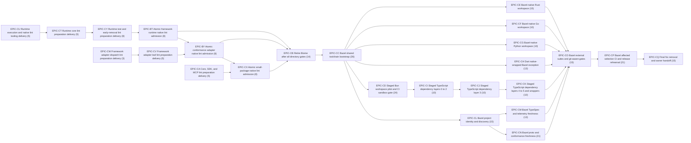

# Critical path

Generated by `constitution-tooling render` from `tasks/epics/`. Do not edit by hand; change the epic files and render again.

## Totals

| Active epics | Open points | Out-of-band epics | Out-of-band points | Waves | Widest wave | Longest chain (points) |
| :--- | :--- | :--- | :--- | :--- | :--- | :--- |
| 25 | 297 | 0 | 0 | 15 | 6 | 187 |

## Longest chain

EPIC-CU → EPIC-CT → EPIC-CY → EPIC-BT → EPIC-BY → EPIC-CX → EPIC-CB → EPIC-CC → EPIC-CD → EPIC-CI → EPIC-CJ → EPIC-CK → EPIC-CO → EPIC-CP → EPIC-CQ (187 points). This bounds wall-clock time however many lanes run.

## Waves

An epic joins a wave when every dependency sits in an earlier wave and it is scope-disjoint from every other epic in the wave. A wave of one is a serial segment.

| Wave | Epic | Kind | Open points | Owns | May patch | Depends on |
| :--- | :--- | :--- | :--- | :--- | :--- | :--- |
| 1 | EPIC-CA Core, SDK, and MCP lint preparation delivery | tooling | 5 | `.changeset/core-sdk-mcp-lint-prep.md`, `.constitution/evidence/KRT-CA002`, `.constitution/evidence/KRT-CA005`, `tools/run-nx.mjs`, `typescript/core/src/capabilities/index.ts`, `typescript/core/src/extensions/index.ts`, `typescript/core/src/lib/capability-shapes.ts`, `typescript/core/src/lib/kernel-records.ts`, `typescript/core/src/lib/payload-codec.ts`, `typescript/core/src/lib/runner-agent-config-snapshot-guards.ts`, `typescript/core/src/lib/runner-contract-guards.ts`, `typescript/core/src/lib/runner-contract-shapes.ts`, `typescript/core/src/lib/runtime-content-approval-predicates.ts`, `typescript/core/src/lib/runtime-context-manifest-predicates.ts`, `typescript/core/src/lib/runtime-contract-predicates.ts`, `typescript/core/src/lib/runtime-data-contract-shapes.ts`, `typescript/core/src/lib/runtime-event-contract-shapes.ts`, `typescript/core/src/lib/runtime-execution-contract-shapes.ts`, `typescript/core/src/lib/runtime-provider-contract-guards.ts`, `typescript/core/src/lib/scope.ts`, `typescript/core/src/lib/secret-pattern-screening.ts`, `typescript/core/src/lib/tuvren-error.ts`, `typescript/core/src/telemetry/index.ts`, `typescript/core/src/telemetry/telemetry-destination.ts`, `typescript/core/test/admission-key-contracts.test.ts`, `typescript/core/test/events-json-schema.test.ts`, `typescript/core/test/payload-codec.test.ts`, `typescript/core/test/runtime-contract-guards-fixtures.ts`, `typescript/core/test/runtime-contract-guards.approval.test.ts`, `typescript/core/test/runtime-contract-guards.execution-shape.test.ts`, `typescript/core/test/runtime-contract-guards.test.ts`, `typescript/core/test/secret-pattern-screening.test.ts`, `typescript/core/tsup.config.ts`, `typescript/sdk/src/lib/create-tuvren.ts`, `typescript/sdk/src/lib/payload-codec.ts`, `typescript/sdk/src/lib/schema-authoring.ts`, `typescript/sdk/test/conversation-state.shreddable-continuity.test.ts`, `typescript/sdk/test/module-resolution.test.ts`, `typescript/sdk/test/payload-codec.context-engineering-rewrite.test.ts`, `typescript/sdk/test/payload-codec.crypto-shredding.test.ts`, `typescript/sdk/test/payload-codec.test.ts`, `typescript/sdk/test/schema-authoring.test.ts`, `typescript/sdk/test/tenant-offboarding.test.ts`, `typescript/sdk/tsup.config.ts`, `typescript/tools/mcp-client/src/lib/mcp-sdk-client.ts`, `typescript/tools/mcp-client/src/lib/mcp-tool-source.ts`, `typescript/tools/mcp-client/test/mcp-client.test.ts`, `typescript/tools/mcp-client/tsup.config.ts` | — | — |
| 1 | EPIC-CU Runtime execution and native lint tooling delivery | tooling | 5 | `.changeset/runtime-execution-tooling-lint-prep.md`, `.constitution/evidence/KRT-CU001`, `tools/scripts/lib/biome-oxc-discovery.test.ts`, `tools/scripts/lib/native-lint-routing-argv.test.ts`, `tools/scripts/lib/native-lint-routing.ts`, `tools/scripts/verify.ts`, `typescript/runtime/src/lib/binding-resolver.ts`, `typescript/runtime/src/lib/capability-attribution.ts`, `typescript/runtime/src/lib/capability-policy-engine.ts`, `typescript/runtime/src/lib/capability-registry.ts`, `typescript/runtime/src/lib/client-endpoint-boundary.ts`, `typescript/runtime/src/lib/context-manifest.ts`, `typescript/runtime/src/lib/durable-reads.ts`, `typescript/runtime/src/lib/execution-timeouts.ts`, `typescript/runtime/src/lib/extension-runtime.ts`, `typescript/runtime/src/lib/handoff-builders.ts`, `typescript/runtime/src/lib/idempotency-identity.ts`, `typescript/runtime/src/lib/orchestration-runtime-lazy-stream.ts`, `typescript/runtime/src/lib/orchestration-runtime-node.ts`, `typescript/runtime/src/lib/orchestration-runtime.ts`, `typescript/runtime/src/lib/payload-codec-seam.ts`, `typescript/runtime/src/lib/runner-registry.ts`, `typescript/runtime/src/lib/runtime-core-iteration.ts`, `typescript/runtime/src/lib/runtime-core-runner-result.ts`, `typescript/runtime/src/lib/runtime-core-runner-support.ts`, `typescript/runtime/src/lib/runtime-execution-handle.ts`, `typescript/runtime/src/lib/runtime-execution-types.ts`, `typescript/runtime/src/lib/server-rate-limiter.ts`, `typescript/runtime/src/lib/telemetry-secret-screening.ts`, `typescript/runtime/src/lib/tool-execution-batch.ts`, `typescript/runtime/src/lib/tool-execution-errors.ts`, `typescript/runtime/src/lib/tool-execution-helpers.ts`, `typescript/runtime/src/lib/tool-execution-resolution.ts`, `typescript/runtime/src/lib/tool-execution-single.ts`, `typescript/runtime/src/lib/tool-execution-staging.ts`, `typescript/runtime/src/lib/tool-execution-validation.ts`, `typescript/runtime/src/lib/tool-execution.ts`, `typescript/runtime/src/lib/tool-registry.ts`, `typescript/runtime/test/admission-key-compatibility.test.ts`, `typescript/runtime/test/admission-key-provider-projection.test.ts`, `typescript/runtime/test/binding-resolver.test.ts`, `typescript/runtime/test/capability-registry.test.ts`, `typescript/runtime/test/client-endpoint-boundary.test.ts`, `typescript/runtime/test/durable-reads.scope-isolation.test.ts`, `typescript/runtime/test/durable-reads.test.ts`, `typescript/runtime/test/extension-runtime.test.ts`, `typescript/runtime/test/fake-run-liveness-kernel.ts`, `typescript/runtime/test/fixtures/admission-key-sqlite-child.ts`, `typescript/runtime/test/idempotency-identity.test.ts`, `typescript/runtime/test/runtime-core-cold-recovery-test-helpers.ts`, `typescript/runtime/test/runtime-core-recovery-comparison.test.ts`, `typescript/runtime/test/runtime-core-recovery-plan.test.ts`, `typescript/runtime/test/runtime-core-shared.test.ts`, `typescript/runtime/test/runtime-core-test-helpers.ts`, `typescript/runtime/test/runtime-core.foundation.test.ts`, `typescript/runtime/tsup.config.ts` | — | — |
| 1 | EPIC-CW Framework adapter dispatch lint preparation delivery | tooling | 3 | `.constitution/evidence/KRT-CW001`, `typescript/conformance-adapter/src/framework-adapter-capability-orchestration-integration.ts`, `typescript/conformance-adapter/src/framework-adapter-capability-orchestration.ts`, `typescript/conformance-adapter/src/framework-adapter-execution-bounds.ts`, `typescript/conformance-adapter/src/framework-adapter-orchestration-lifecycle.ts`, `typescript/conformance-adapter/src/framework-adapter-orchestration.ts`, `typescript/conformance-adapter/src/framework-adapter-runner.ts`, `typescript/conformance-adapter/src/framework-adapter-runtime.ts`, `typescript/conformance-adapter/src/framework-adapter-tuvren-client-execution-class.ts`, `typescript/conformance-adapter/src/framework-adapter-tuvren-server-execution-class.ts` | — | — |
| 2 | EPIC-CT Runtime core lint preparation delivery | tooling | 5 | `.changeset/runtime-core-lint-prep.md`, `.constitution/evidence/KRT-CT001`, `typescript/runtime/src/lib/runtime-core-assistant-validation-sequences.ts`, `typescript/runtime/src/lib/runtime-core-assistant-validation.ts`, `typescript/runtime/src/lib/runtime-core-bounds.ts`, `typescript/runtime/src/lib/runtime-core-context-ops.ts`, `typescript/runtime/src/lib/runtime-core-context.ts`, `typescript/runtime/src/lib/runtime-core-events.ts`, `typescript/runtime/src/lib/runtime-core-execution-controller.ts`, `typescript/runtime/src/lib/runtime-core-execution-orchestration.ts`, `typescript/runtime/src/lib/runtime-core-expired-recovery.ts`, `typescript/runtime/src/lib/runtime-core-facade-adapters.ts`, `typescript/runtime/src/lib/runtime-core-facade-execution.ts`, `typescript/runtime/src/lib/runtime-core-facade-hosts.ts`, `typescript/runtime/src/lib/runtime-core-facade-ops.ts`, `typescript/runtime/src/lib/runtime-core-facade-utils.ts`, `typescript/runtime/src/lib/runtime-core-finalization.ts`, `typescript/runtime/src/lib/runtime-core-head-state.ts`, `typescript/runtime/src/lib/runtime-core-hosts-execution.ts`, `typescript/runtime/src/lib/runtime-core-hosts-persistence.ts`, `typescript/runtime/src/lib/runtime-core-hosts.ts`, `typescript/runtime/src/lib/runtime-core-interrupted-metadata.ts`, `typescript/runtime/src/lib/runtime-core-liveness.ts`, `typescript/runtime/src/lib/runtime-core-observability.ts`, `typescript/runtime/src/lib/runtime-core-options.ts`, `typescript/runtime/src/lib/runtime-core-persistence.ts`, `typescript/runtime/src/lib/runtime-core-recovery-plan.ts`, `typescript/runtime/src/lib/runtime-core-recovery.ts`, `typescript/runtime/src/lib/runtime-core-response.ts`, `typescript/runtime/src/lib/runtime-core-runner.ts`, `typescript/runtime/src/lib/runtime-core-runtime-lifecycle.ts`, `typescript/runtime/src/lib/runtime-core-shared.ts`, `typescript/runtime/src/lib/runtime-core-startup.ts`, `typescript/runtime/src/lib/runtime-core-state-commit.ts`, `typescript/runtime/src/lib/runtime-core-status.ts`, `typescript/runtime/src/lib/runtime-core-telemetry.ts`, `typescript/runtime/src/lib/runtime-core-tool-batch-finalization.ts`, `typescript/runtime/src/lib/runtime-core-tool-resume.ts`, `typescript/runtime/src/lib/runtime-core-transition-support.ts`, `typescript/runtime/src/lib/runtime-core-turn-progress.ts`, `typescript/runtime/src/lib/runtime-core.ts` | — | EPIC-CU |
| 2 | EPIC-CV Framework adapter leaf lint preparation delivery | tooling | 5 | `.constitution/evidence/KRT-CV001`, `typescript/conformance-adapter/src/batteries-included-node-host.ts`, `typescript/conformance-adapter/src/framework-adapter-admission-key-crash.ts`, `typescript/conformance-adapter/src/framework-adapter-admission-key-session.ts`, `typescript/conformance-adapter/src/framework-adapter-batteries-included.ts`, `typescript/conformance-adapter/src/framework-adapter-capability-policy.ts`, `typescript/conformance-adapter/src/framework-adapter-event-stream-resume.ts`, `typescript/conformance-adapter/src/framework-adapter-event-stream.ts`, `typescript/conformance-adapter/src/framework-adapter-input.ts`, `typescript/conformance-adapter/src/framework-adapter-invocation-lifecycle.ts`, `typescript/conformance-adapter/src/framework-adapter-provider-scenarios.ts`, `typescript/conformance-adapter/src/framework-adapter-proving-host.ts`, `typescript/conformance-adapter/src/framework-adapter-recovery-result.ts`, `typescript/conformance-adapter/src/framework-adapter-recovery-scenarios.ts`, `typescript/conformance-adapter/src/framework-adapter-runtime-lifecycle-scenarios.ts`, `typescript/conformance-adapter/src/framework-adapter-runtime-scenarios.ts`, `typescript/conformance-adapter/src/framework-adapter-runtime-telemetry-scenarios.ts`, `typescript/conformance-adapter/src/framework-adapter-schema-authoring.ts`, `typescript/conformance-adapter/src/framework-adapter-secret-isolation.ts`, `typescript/conformance-adapter/src/framework-adapter-session-lifecycle.ts`, `typescript/conformance-adapter/src/framework-adapter-session.ts`, `typescript/conformance-adapter/src/framework-adapter-trust-boundary.ts`, `typescript/conformance-adapter/src/framework-adapter.ts`, `typescript/conformance-adapter/tsup.config.batteries-included.ts` | — | EPIC-CW |
| 3 | EPIC-CY Runtime test and early-removal lint preparation delivery | tooling | 8 | `.changeset/runtime-regression-lint-prep.md`, `.constitution/evidence/KRT-BT002`, `.constitution/evidence/KRT-CY001`, `typescript/runtime/src/lib/runtime-core-execution-session.ts`, `typescript/runtime/test/admission-key-persistence.test.ts`, `typescript/runtime/test/capability-attribution.test.ts`, `typescript/runtime/test/capability-policy-engine.test.ts`, `typescript/runtime/test/invocation-lifecycle.cross-class.test.ts`, `typescript/runtime/test/invocation-lifecycle.observation-taxonomy.test.ts`, `typescript/runtime/test/invocation-lifecycle.resume-recovery.test.ts`, `typescript/runtime/test/invocation-lifecycle.telemetry-depth.test.ts`, `typescript/runtime/test/orchestration-runtime.approval.test.ts`, `typescript/runtime/test/orchestration-runtime.child-lifecycle.test.ts`, `typescript/runtime/test/orchestration-runtime.test.ts`, `typescript/runtime/test/runtime-core-expired-recovery.test.ts`, `typescript/runtime/test/runtime-core-recovery-test-helpers.ts`, `typescript/runtime/test/runtime-core.approval-basics.test.ts`, `typescript/runtime/test/runtime-core.approval-decisions.test.ts`, `typescript/runtime/test/runtime-core.approval-lifecycle.test.ts`, `typescript/runtime/test/runtime-core.approval-resume.test.ts`, `typescript/runtime/test/runtime-core.approval.test.ts`, `typescript/runtime/test/runtime-core.around-tool-approval.test.ts`, `typescript/runtime/test/runtime-core.malformed-approval.test.ts`, `typescript/runtime/test/runtime-core.recovery-cold-batch-regressions.test.ts`, `typescript/runtime/test/runtime-core.recovery-guards.test.ts`, `typescript/runtime/test/runtime-core.recovery-order-repair-window.test.ts`, `typescript/runtime/test/runtime-core.recovery.test.ts`, `typescript/runtime/test/runtime-core.stale-step-recovery.test.ts`, `typescript/runtime/test/runtime-core.telemetry.test.ts`, `typescript/runtime/test/runtime-module-initialization.test.ts`, `typescript/runtime/test/server-execution-class.ax001-validation.test.ts`, `typescript/runtime/test/server-execution-class.ax002-retry.test.ts`, `typescript/runtime/test/server-execution-class.ax003-rate-limit.test.ts`, `typescript/runtime/test/server-execution-class.ax004-sandbox-mcp.test.ts`, `typescript/runtime/test/server-execution-class.ax005-audit.test.ts`, `typescript/runtime/test/server-execution-class.bg004-authority-loss.test.ts`, `typescript/runtime/test/stream-adapters.test.ts` | — | EPIC-CT |
| 4 | EPIC-BT Atomic framework runtime native lint admission | tooling | 8 | `.changeset/toolchain-bt-runtime-lint.md`, `.constitution/evidence/KRT-BT004`, `tools/biome-coverage/bt.json`, `typescript/runtime/bench/runtime-boundary.bench.ts`, `typescript/runtime/project.json`, `typescript/runtime/src/index.ts`, `typescript/runtime/src/lib/runtime-core-loop.ts`, `typescript/runtime/test/fake-kernel.ts`, `typescript/runtime/test/orchestration-runtime-runner-helpers.ts`, `typescript/runtime/test/runtime-core.after-iteration.test.ts`, `typescript/runtime/test/runtime-core.assistant-stream.test.ts`, `typescript/runtime/test/runtime-core.await-result.test.ts`, `typescript/runtime/test/runtime-core.bootstrap.test.ts`, `typescript/runtime/test/runtime-core.client-endpoint.test.ts`, `typescript/runtime/test/runtime-core.context-engineering.test.ts`, `typescript/runtime/test/runtime-core.execution-bounds.test.ts`, `typescript/runtime/test/runtime-core.execution-lifecycle.test.ts`, `typescript/runtime/test/runtime-core.handoff-builders.test.ts`, `typescript/runtime/test/runtime-core.handoff-runner.test.ts`, `typescript/runtime/test/runtime-core.hooks.test.ts`, `typescript/runtime/test/runtime-core.lifecycle.test.ts`, `typescript/runtime/test/runtime-core.orchestration.test.ts`, `typescript/runtime/test/runtime-core.parallel-batching.test.ts`, `typescript/runtime/test/runtime-core.provider-execution-class.test.ts`, `typescript/runtime/test/runtime-core.reasoning-stream.test.ts`, `typescript/runtime/test/runtime-core.runner-boundary.test.ts`, `typescript/runtime/test/runtime-core.sanitize-tool-result.test.ts`, `typescript/runtime/test/runtime-core.steering.test.ts`, `typescript/runtime/test/runtime-core.stream-synthesis.test.ts`, `typescript/runtime/test/runtime-core.stream-validation.test.ts`, `typescript/runtime/test/runtime-core.tool-batching.test.ts`, `typescript/runtime/test/runtime-core.tool-failures.test.ts`, `typescript/runtime/test/runtime-core.tooling.test.ts`, `typescript/runtime/test/runtime-core.turn-linking.test.ts` | — | EPIC-CY |
| 5 | EPIC-BY Atomic conformance adapter native lint admission | tooling | 8 | `.constitution/evidence/KRT-BY002`, `.constitution/evidence/KRT-BY004`, `tools/biome-coverage/by.json`, `tools/scripts/verify.ts`, `typescript/conformance-adapter/project.json`, `typescript/conformance-adapter/src/framework-adapter-admission-key.ts`, `typescript/conformance-adapter/src/framework-adapter-event-stream-sse.ts`, `typescript/conformance-adapter/src/framework-adapter-event-stream-ws.ts`, `typescript/conformance-adapter/test/host-protocol.test.zsh`, `typescript/kernel/conformance-adapter/project.json`, `typescript/kernel/conformance-adapter/src/host-protocol-logical-scenarios.ts`, `typescript/kernel/conformance-adapter/src/host-reclamation-scenarios.ts`, `typescript/kernel/conformance-adapter/src/host-restart-recovery-scenarios.ts`, `typescript/kernel/conformance-adapter/src/host-run-liveness-scenarios.ts`, `typescript/kernel/conformance-adapter/src/host-scenario-support.ts`, `typescript/kernel/conformance-adapter/src/host-support.ts`, `typescript/kernel/conformance-adapter/src/host.ts`, `typescript/kernel/conformance-adapter/src/sqlite-restart-recovery-scenario.ts`, `typescript/kernel/conformance-adapter/tsup.config.ts`, `typescript/providers/conformance-adapter/project.json`, `typescript/providers/conformance-adapter/src/host.ts`, `typescript/providers/conformance-adapter/src/provider-conformance-fixtures.ts`, `typescript/providers/conformance-adapter/src/provider-mediated-execution-class.ts`, `typescript/providers/conformance-adapter/src/provider-native-execution-class.ts`, `typescript/providers/conformance-adapter/test/host-protocol.test.zsh` | — | EPIC-BT, EPIC-CV |
| 6 | EPIC-CX Atomic small-package native lint admission | tooling | 8 | `.changeset/toolchain-ca-small-package-lint.md`, `.constitution/evidence/KRT-CA004`, `.constitution/evidence/KRT-CX001`, `tools/biome-coverage/ca.json`, `typescript/certification-batteries-included/project.json`, `typescript/certification/project.json`, `typescript/certification/test/framework-typescript-conformance.test.ts`, `typescript/core/project.json`, `typescript/core/src/errors/index.ts`, `typescript/core/src/events/index.ts`, `typescript/core/src/execution/index.ts`, `typescript/core/src/index.ts`, `typescript/core/src/lib/runner-contracts.ts`, `typescript/core/src/lib/runtime-contract-guards.ts`, `typescript/core/src/lib/runtime-contract-shapes.ts`, `typescript/core/src/lifecycle/index.ts`, `typescript/core/src/messages/index.ts`, `typescript/core/src/provider/index.ts`, `typescript/core/src/runner/index.ts`, `typescript/core/src/security/index.ts`, `typescript/core/src/tools/index.ts`, `typescript/core/test/runner-contract-guards.test.ts`, `typescript/core/test/runtime-contract-guards.tool-definition.test.ts`, `typescript/sdk/project.json`, `typescript/sdk/src/advanced.ts`, `typescript/sdk/src/index.ts`, `typescript/sdk/test/create-tuvren.test.ts`, `typescript/streaming/agui/project.json`, `typescript/streaming/agui/smoke/package-exports.ts`, `typescript/streaming/agui/src/index.ts`, `typescript/streaming/agui/src/lib/stream-agui.ts`, `typescript/streaming/agui/test/stream-agui.test.ts`, `typescript/streaming/agui/tsup.config.ts`, `typescript/streaming/core/project.json`, `typescript/streaming/core/smoke/package-exports.ts`, `typescript/streaming/core/src/index.ts`, `typescript/streaming/core/src/lib/stream-core.ts`, `typescript/streaming/core/src/lib/stream-resume.ts`, `typescript/streaming/core/test/stream-core.test.ts`, `typescript/streaming/core/test/stream-resume.test.ts`, `typescript/streaming/core/tsup.config.ts`, `typescript/streaming/sse/project.json`, `typescript/streaming/sse/smoke/package-exports.ts`, `typescript/streaming/sse/src/index.ts`, `typescript/streaming/sse/src/lib/sse-decoder.ts`, `typescript/streaming/sse/src/lib/stream-sse.ts`, `typescript/streaming/sse/test/sse-decoder.test.ts`, `typescript/streaming/sse/test/stream-sse.test.ts`, `typescript/streaming/sse/tsup.config.ts`, `typescript/streaming/ws/project.json`, `typescript/streaming/ws/smoke/package-exports.ts`, `typescript/streaming/ws/src/index.ts`, `typescript/streaming/ws/src/lib/ws-close-codes.ts`, `typescript/streaming/ws/src/lib/ws-messages.ts`, `typescript/streaming/ws/src/lib/ws-session-transport.ts`, `typescript/streaming/ws/test/session-test-helpers.ts`, `typescript/streaming/ws/test/ws-session-transport.test.ts`, `typescript/streaming/ws/test/ws-transport-policies.test.ts`, `typescript/streaming/ws/tsup.config.ts`, `typescript/telemetry/otel/project.json`, `typescript/telemetry/otel/src/index.ts`, `typescript/telemetry/otel/src/lib/otel-telemetry-sink.ts`, `typescript/telemetry/otel/tsup.config.ts`, `typescript/telemetry/semconv/project.json`, `typescript/telemetry/semconv/src/index.ts`, `typescript/telemetry/semconv/tsup.config.ts`, `typescript/testkit/project.json`, `typescript/testkit/src/index.ts`, `typescript/testkit/src/lib/framework-testkit.ts`, `typescript/testkit/tsup.config.ts`, `typescript/tools/mcp-client/project.json`, `typescript/tools/mcp-client/src/index.ts` | — | EPIC-BY, EPIC-CA |
| 7 | EPIC-CB Retire Biome after all directory gates | tooling | 14 | `package.json`, `bun.lock`, `biome.jsonc`, `nx.json`, `.github/dependabot.yml`, `devenv.nix`, `oxlint.config.ts`, `oxfmt.config.ts`, `typescript`, `spec`, `tools`, `reports/compatibility/project.json`, `docs/guides/add-a-driver.md`, `.constitution/tech-spec/stack.yaml`, `.git-blame-ignore-revs`, `.changeset/toolchain-cb-biome-retirement.md` | `.constitution/tech-spec/stack.yaml` | EPIC-BT, EPIC-BY, EPIC-CX |
| 8 | EPIC-CC Bazel shared toolchain bootstrap | tooling | 26 | `MODULE.bazel`, `MODULE.bazel.lock`, `.bazelversion`, `.bazelrc`, `.bazelignore`, `devenv.nix`, `devenv.lock`, `.gitignore`, `user.bazelrc`, `go.work`, `tools/bazel/toolchain-sync.ts`, `tools/bazel/toolchain-sync.test.ts`, `tools/bazel/toolchain-sync.bzl`, `tools/bazel/BUILD.bazel`, `.constitution/tech-spec/stack.yaml`, `go/kernel/BUILD.bazel`, `go/kernel-conformance-adapter/BUILD.bazel`, `go/kernel-certification/BUILD.bazel`, `tools/bazel/python-requirements.txt` | `.constitution/tech-spec/stack.yaml` | EPIC-CB |
| 9 | EPIC-CD Staged Bun workspace pilot and CI sandbox gate | tooling | 24 | `tools/bazel/bun-workspace.bzl`, `tools/bazel/ts-package.bzl`, `tools/bazel/ts-runner.sh`, `typescript/core/BUILD.bazel`, `typescript/kernel/protocol/BUILD.bazel`, `typescript/kernel/runtime/BUILD.bazel`, `.github/workflows/ci.yml`, `MODULE.bazel`, `MODULE.bazel.lock`, `.changeset/toolchain-cd-staged-bun-pilot.md` | — | EPIC-CC |
| 9 | EPIC-CE Bazel-native Rust workspace | tooling | 15 | `rust/kernel/BUILD.bazel`, `rust/kernel-grpc-service/BUILD.bazel`, `rust/conformance-adapter/BUILD.bazel`, `rust/kernel-conformance-adapter/BUILD.bazel`, `rust/certification/BUILD.bazel`, `rust/kernel-certification/BUILD.bazel`, `tools/bazel/rust.bzl` | — | EPIC-CC |
| 9 | EPIC-CF Bazel-native Go workspace | tooling | 10 | `go/kernel/BUILD.bazel`, `go/kernel-conformance-adapter/BUILD.bazel`, `go/kernel-certification/BUILD.bazel`, `tools/bazel/go.bzl` | — | EPIC-CC |
| 9 | EPIC-CG Bazel-native Python workspace | tooling | 10 | `python/kernel/BUILD.bazel`, `python/kernel-conformance-adapter/BUILD.bazel`, `python/kernel-certification/BUILD.bazel`, `tools/bazel/python.bzl`, `tools/bazel/python-requirements.txt`, `tools/bazel/python-lock-drift.sh` | — | EPIC-CC |
| 9 | EPIC-CH Dart native-wrapped Bazel exception | tooling | 13 | `dart/kernel/BUILD.bazel`, `dart/kernel-conformance-adapter/BUILD.bazel`, `dart/kernel-certification/BUILD.bazel`, `dart/kernel-conformance-adapter/test/protocol_test.dart`, `tools/bazel/dart.bzl`, `tools/bazel/dart-runner.sh` | — | EPIC-CC |
| 9 | EPIC-CL Bazel project identity and discovery | tooling | 15 | `tools/bazel/project-tags.bzl`, `tools/bazel/project-manifest.bzl`, `tools/bazel/projects.json`, `tools/scripts/lib/nx-projects.ts`, `tools/scripts/validate-workspace-test-coverage.ts`, `tools/scripts/lib/regenerate-command-argv.ts`, `tools/scripts/lib/regenerate-command-argv.test.ts` | — | EPIC-CC |
| 10 | EPIC-CI Staged TypeScript dependency layers 0 to 2 | tooling | 10 | `typescript/host/session-client/BUILD.bazel`, `typescript/telemetry/semconv/BUILD.bazel`, `typescript/host/session/BUILD.bazel`, `typescript/providers/provider-api/BUILD.bazel`, `typescript/streaming/core/BUILD.bazel`, `typescript/telemetry/otel/BUILD.bazel`, `typescript/testkit/BUILD.bazel`, `typescript/host/remote-session/BUILD.bazel`, `typescript/kernel/backends/shared/BUILD.bazel`, `typescript/kernel/grpc-client/BUILD.bazel`, `typescript/providers/bridge-ai-sdk/BUILD.bazel`, `typescript/providers/testkit/BUILD.bazel`, `typescript/runners/react/BUILD.bazel`, `typescript/runtime/BUILD.bazel`, `typescript/streaming/agui/BUILD.bazel`, `typescript/streaming/sse/BUILD.bazel`, `.changeset/toolchain-ci-bazel-ts-kernel-runtime.md` | — | EPIC-CD |
| 10 | EPIC-CM Bazel TypeSpec and telemetry freshness | tooling | 13 | `tools/bazel/source-codegen.bzl`, `tools/bazel/source-codegen-runner.sh`, `tools/scripts/codegen.ts`, `tools/scripts/telemetry-codegen.ts`, `tools/generators`, `spec/core`, `spec/providers`, `spec/runners`, `spec/tools`, `spec/host`, `spec/streaming`, `spec/telemetry`, `typescript/telemetry/semconv/src/lib/generated`, `rust/kernel/src/generated/tuvren_runtime_telemetry.rs`, `tools/bazel/source-codegen`, `.changeset/toolchain-cm-bazel-source-codegen.md` | — | EPIC-CL |
| 10 | EPIC-CN Bazel proto and conformance freshness | tooling | 21 | `tools/bazel/interop-codegen.bzl`, `tools/bazel/interop-codegen-runner.sh`, `tools/scripts/conformance`, `tools/scripts/compatibility-report.ts`, `tools/scripts/api-freeze-gate.ts`, `tools/scripts/__snapshots__`, `spec/interop`, `spec/kernel`, `spec/conformance`, `reports/compatibility`, `typescript/kernel/grpc-client/src/lib/generated/kernel-interop`, `tools/bazel/interop-codegen`, `.changeset/toolchain-cn-bazel-interop-codegen.md` | — | EPIC-CL |
| 11 | EPIC-CJ Staged TypeScript dependency layer 3 | tooling | 10 | `typescript/kernel/backends/memory/BUILD.bazel`, `typescript/kernel/backends/postgres/BUILD.bazel`, `typescript/kernel/backends/sqlite/BUILD.bazel`, `typescript/kernel/testkit/BUILD.bazel`, `typescript/certification/BUILD.bazel`, `typescript/sdk/BUILD.bazel`, `typescript/streaming/ws/BUILD.bazel`, `.changeset/toolchain-cj-bazel-ts-host-adapters.md` | — | EPIC-CI |
| 12 | EPIC-CK Staged TypeScript dependency layers 4 to 5 and wrappers | tooling | 10 | `typescript/kernel/certification/BUILD.bazel`, `typescript/providers/certification/BUILD.bazel`, `typescript/tools/mcp-client/BUILD.bazel`, `typescript/conformance-adapter/BUILD.bazel`, `typescript/kernel/conformance-adapter/BUILD.bazel`, `typescript/providers/conformance-adapter/BUILD.bazel`, `typescript/host/repl/BUILD.bazel`, `typescript/kernel/certification-sqlite/BUILD.bazel`, `typescript/kernel/certification-postgres/BUILD.bazel`, `typescript/certification-batteries-included/BUILD.bazel`, `.changeset/toolchain-ck-bazel-ts-packages.md` | — | EPIC-CJ |
| 13 | EPIC-CO Bazel external suites and git-aware gates | tooling | 15 | `tools/bazel/service-tests.bzl`, `tools/bazel/service-test-runner.sh`, `tools/bazel/git-gates.bzl`, `tools/conformance`, `tools/scripts/conformance.ts`, `tools/scripts/lib/worktree-guard.ts`, `tools/scripts/changeset-check.ts`, `tools/scripts/changeset-check.test.ts`, `tools/scripts/check.ts`, `tools/scripts/kernel-interop-governance.ts`, `tools/scripts/repl-host-interop-smoke.ts`, `tools/scripts/proving-host-sqlite-pinned.sh`, `BUILD.bazel` | — | EPIC-CE, EPIC-CF, EPIC-CG, EPIC-CH, EPIC-CK, EPIC-CM, EPIC-CN |
| 14 | EPIC-CP Bazel affected selection CI and release rehearsal | tooling | 21 | `tools/bazel/affected-selection`, `tools/scripts/publish-registry.ts`, `tools/scripts/release-check.ts`, `tools/scripts/release-lane.ts`, `.github/workflows/ci.yml`, `.github/workflows/release.yml`, `.github/dependabot.yml`, `package.json`, `bun.lock` | — | EPIC-CO |
| 15 | EPIC-CQ Final Nx removal and owner handoff | tooling | 15 | `nx.json`, `package.json`, `bun.lock`, `tools/run-nx.mjs`, `tools/nx`, `tools/bazel/nx-run.sh`, `tools/bazel/native_binary.bzl`, `tools/bazel/BUILD.bazel`, `tools/scripts/verify.ts`, `tools/scripts/verify-kernel.ts`, `tools/scripts/check.ts`, `tools/scripts/lib/nx-projects.ts`, `.github/workflows/ci.yml`, `CLAUDE.md`, `AGENTS.md`, `BUILD.bazel`, `typescript`, `rust`, `go`, `python`, `dart`, `spec`, `reports/compatibility`, `.constitution/tech-spec/stack.yaml`, `.constitution/tech-spec/guidelines.md`, `.constitution/tech-spec/adrs/ADR-0069-public-release-discipline.md`, `tools/scripts/lib/project-manifest.ts`, `.changeset/toolchain-cq-nx-final-cutover.md` | `.constitution/tech-spec/stack.yaml`, `.constitution/tech-spec/guidelines.md`, `.constitution/tech-spec/adrs/ADR-0069-public-release-discipline.md` | EPIC-CP |

## Build order

An arrow points from a prerequisite to the epic that depends on it, so it reads in the order work flows, the same direction as the longest chain above.

## Ticket order inside each epic

A dependency-respecting listing, not a chain: `needs` names a ticket's own `depends_on` inside its epic, and a ticket without one has no in-epic dependency. Readiness is epic-level: a ticket finished on an unmerged branch satisfies no other epic's dependency until the containing PR merges.

- **EPIC-BT:** KRT-BT004
- **EPIC-BY:** KRT-BY004
- **EPIC-CA:** KRT-CA005
- **EPIC-CB:** KRT-CB001, KRT-CB002 (needs KRT-CB001), KRT-CB003 (needs KRT-CB002), KRT-CB004 (needs KRT-CB003), KRT-CB005 (done)
- **EPIC-CC:** KRT-CC001, KRT-CC002 (needs KRT-CC001), KRT-CC003 (needs KRT-CC002), KRT-CC004 (needs KRT-CC003), KRT-CC005 (needs KRT-CC004)
- **EPIC-CD:** KRT-CD001, KRT-CD002 (needs KRT-CD001), KRT-CD003 (needs KRT-CD002)
- **EPIC-CE:** KRT-CE001, KRT-CE002 (needs KRT-CE001), KRT-CE003 (needs KRT-CE002)
- **EPIC-CF:** KRT-CF001, KRT-CF002 (needs KRT-CF001)
- **EPIC-CG:** KRT-CG001, KRT-CG002 (needs KRT-CG001)
- **EPIC-CH:** KRT-CH001, KRT-CH002 (needs KRT-CH001)
- **EPIC-CI:** KRT-CI001, KRT-CI002 (needs KRT-CI001)
- **EPIC-CJ:** KRT-CJ001, KRT-CJ002 (needs KRT-CJ001)
- **EPIC-CK:** KRT-CK001, KRT-CK002 (needs KRT-CK001)
- **EPIC-CL:** KRT-CL001, KRT-CL002 (needs KRT-CL001), KRT-CL003 (needs KRT-CL002)
- **EPIC-CM:** KRT-CM001, KRT-CM002 (needs KRT-CM001), KRT-CM003 (needs KRT-CM002)
- **EPIC-CN:** KRT-CN001, KRT-CN002 (needs KRT-CN001), KRT-CN003 (needs KRT-CN002), KRT-CN004 (needs KRT-CN003)
- **EPIC-CO:** KRT-CO001, KRT-CO002 (needs KRT-CO001), KRT-CO003 (needs KRT-CO002)
- **EPIC-CP:** KRT-CP001, KRT-CP002 (needs KRT-CP001), KRT-CP003 (needs KRT-CP002), KRT-CP004 (needs KRT-CP003)
- **EPIC-CQ:** KRT-CQ001, KRT-CQ002 (needs KRT-CQ001), KRT-CQ003 (needs KRT-CQ002), KRT-CQ004 (needs KRT-CQ003)
- **EPIC-CT:** KRT-CT001
- **EPIC-CU:** KRT-CU001
- **EPIC-CV:** KRT-CV001
- **EPIC-CW:** KRT-CW001
- **EPIC-CX:** KRT-CX001
- **EPIC-CY:** KRT-CY001

## Concurrency mechanics

- **Worktree:** ../framework-worktrees/EPIC-<ID>
- **Branch naming:** epic/<lowercase-id>-<slug>
- **Merge strategy:** rebase
