# Critical path

Generated by `constitution-tooling render` from `tasks/epics/`. Do not edit by hand; change the epic files and render again.

## Totals

| Active epics | Open points | Out-of-band epics | Out-of-band points | Waves | Widest wave | Longest chain (points) |
| :--- | :--- | :--- | :--- | :--- | :--- | :--- |
| 25 | 458 | 0 | 0 | 15 | 6 | 307 |

## Longest chain

EPIC-CZ → EPIC-DB → EPIC-DC → EPIC-DD → EPIC-DE → EPIC-DF → EPIC-CB → EPIC-CC → EPIC-CD → EPIC-CI → EPIC-CJ → EPIC-CK → EPIC-CO → EPIC-CP → EPIC-CQ (307 points). This bounds wall-clock time however many lanes run.

## Waves

An epic joins a wave when every dependency sits in an earlier wave and it is scope-disjoint from every other epic in the wave. A wave of one is a serial segment.

| Wave | Epic | Kind | Open points | Owns | May patch | Depends on |
| :--- | :--- | :--- | :--- | :--- | :--- | :--- |
| 1 | EPIC-CZ Certification integrity floor, pinned contracts, and negative-control baseline | foundation | 43 | `tools/conformance/harness`, `tools/conformance/plan-compiler`, `tools/conformance/meta-conformance`, `tools/conformance/adapter-protocol`, `tools/conformance/certification`, `tools/schemas`, `tools/scripts/lib/conformance-contract.ts`, `tools/scripts/compatibility-report.ts`, `tools/scripts/authority-guardrails`, `tools/scripts/conformance`, `reports/compatibility`, `spec/conformance`, `typescript/kernel/testkit`, `typescript/kernel/conformance-adapter`, `spec/kernel/authority-packet.json` | `.constitution/tech-spec/contracts/conformance-certification.md`, `.constitution/tech-spec/contracts/conformance-operation-catalog.meta.yaml`, `.constitution/tech-spec/contracts/conformance-observation-encoding.meta.yaml`, `.constitution/tech-spec/contracts/conformance-adapter-protocol.meta.yaml`, `.constitution/tech-spec/contracts/certification-profile.meta.yaml`, `.constitution/tech-spec/contracts/negative-control-manifest.meta.yaml`, `.constitution/tech-spec/contracts/certification-evidence.meta.yaml` | — |
| 2 | EPIC-DB Kernel catalog, lossless encoding, and protocol plans on the TypeScript memory kernel | product | 24 | `spec/conformance/kernel`, `spec/kernel`, `docs/KrakenKernelSpecification.md`, `tools/conformance/harness`, `tools/conformance/plan-compiler`, `tools/conformance/meta-conformance`, `tools/scripts/conformance`, `typescript/kernel/conformance-adapter`, `typescript/kernel/testkit`, `typescript/kernel/runtime`, `typescript/kernel/protocol`, `typescript/kernel/backends/memory`, `.changeset/certification-db-kernel-protocol.md` | `.constitution/tech-spec/contracts/kernel-identity-recipes.meta.yaml`, `.constitution/tech-spec/contracts/conformance-operation-catalog.meta.yaml` | EPIC-CZ |
| 3 | EPIC-DC Isolation, reclamation, liveness, and in-process recovery on the TypeScript memory kernel | product | 21 | `spec/conformance/kernel`, `spec/kernel/authority-packet.json`, `tools/conformance/harness`, `tools/conformance/plan-compiler`, `tools/conformance/meta-conformance`, `tools/conformance/certification`, `tools/scripts/conformance`, `typescript/kernel/conformance-adapter`, `typescript/kernel/testkit`, `typescript/kernel/runtime`, `typescript/kernel/backends/memory`, `typescript/kernel/backends/shared`, `reports/compatibility`, `.changeset/certification-dc-kernel-memory.md` | `.constitution/tech-spec/contracts/certification-profile.meta.yaml` | EPIC-DB |
| 4 | EPIC-DD Certify the Rust kernel on the kernel catalog | product | 23 | `rust/kernel`, `rust/kernel-conformance-adapter`, `rust/kernel-certification`, `spec/conformance/kernel`, `tools/conformance/meta-conformance`, `tools/conformance/certification`, `reports/compatibility` | `.constitution/tech-spec/contracts/kernel-identity-recipes.meta.yaml` | EPIC-DC |
| 5 | EPIC-DE Adapter protocol 0.2 orchestration for races, cancellation, and live streams | product | 23 | `tools/conformance/harness`, `tools/conformance/adapter-protocol`, `tools/conformance/meta-conformance`, `spec/conformance/kernel`, `typescript/kernel/conformance-adapter`, `typescript/kernel/testkit`, `rust/kernel`, `rust/kernel-conformance-adapter` | `.constitution/tech-spec/contracts/conformance-adapter-protocol.meta.yaml` | EPIC-DD |
| 6 | EPIC-DF Durable lifecycle certification for SQLite and PostgreSQL | product | 28 | `tools/conformance/harness`, `tools/conformance/adapter-protocol`, `tools/conformance/meta-conformance`, `tools/conformance/certification`, `spec/conformance/kernel`, `typescript/kernel/conformance-adapter`, `typescript/kernel/testkit`, `typescript/kernel/backends/sqlite`, `typescript/kernel/backends/postgres`, `typescript/kernel/certification-sqlite`, `typescript/kernel/certification-postgres`, `reports/compatibility/evidence/certification-harness.kernel-typescript-sqlite-certification.json`, `reports/compatibility/evidence/certification-harness.kernel-typescript-postgres-certification.json`, `.changeset/certification-df-durable-backends.md` | `.constitution/tech-spec/contracts/certification-profile.meta.yaml` | EPIC-DE |
| 6 | EPIC-DG Certify the Go kernel on the kernel catalog | product | 18 | `go/kernel`, `go/kernel-conformance-adapter`, `go/kernel-certification`, `reports/compatibility/evidence/certification-harness.kernel-go-certification.json` | — | EPIC-DE |
| 6 | EPIC-DH Certify the Python kernel on the kernel catalog | product | 18 | `python/kernel`, `python/kernel-conformance-adapter`, `python/kernel-certification`, `reports/compatibility/evidence/certification-harness.kernel-python-certification.json` | — | EPIC-DE |
| 6 | EPIC-DI Certify the Dart kernel on the kernel catalog | product | 18 | `dart/kernel`, `dart/kernel-conformance-adapter`, `dart/kernel-certification`, `reports/compatibility/evidence/certification-harness.kernel-dart-certification.json` | — | EPIC-DE |
| 7 | EPIC-CB Retire Biome after all directory gates | tooling | 14 | `package.json`, `bun.lock`, `biome.jsonc`, `nx.json`, `.github/dependabot.yml`, `devenv.nix`, `oxlint.config.ts`, `oxfmt.config.ts`, `typescript`, `spec`, `tools`, `reports/compatibility/project.json`, `docs/guides/add-a-driver.md`, `.constitution/tech-spec/stack.yaml`, `.git-blame-ignore-revs`, `.changeset/toolchain-cb-biome-retirement.md` | `.constitution/tech-spec/stack.yaml` | EPIC-DF, EPIC-DG, EPIC-DH, EPIC-DI |
| 8 | EPIC-CC Bazel shared toolchain bootstrap | tooling | 26 | `MODULE.bazel`, `MODULE.bazel.lock`, `.bazelversion`, `.bazelrc`, `.bazelignore`, `devenv.nix`, `devenv.lock`, `.gitignore`, `user.bazelrc`, `go.work`, `tools/bazel/toolchain-sync.ts`, `tools/bazel/toolchain-sync.test.ts`, `tools/bazel/toolchain-sync.bzl`, `tools/bazel/BUILD.bazel`, `.constitution/tech-spec/stack.yaml`, `go/kernel/BUILD.bazel`, `go/kernel-conformance-adapter/BUILD.bazel`, `go/kernel-certification/BUILD.bazel`, `tools/bazel/python-requirements.txt` | `.constitution/tech-spec/stack.yaml` | EPIC-CB |
| 9 | EPIC-CD Staged Bun workspace pilot and CI sandbox gate | tooling | 24 | `tools/bazel/bun-workspace.bzl`, `tools/bazel/ts-package.bzl`, `tools/bazel/ts-runner.sh`, `typescript/core/BUILD.bazel`, `typescript/kernel/protocol/BUILD.bazel`, `typescript/kernel/runtime/BUILD.bazel`, `.github/workflows/ci.yml`, `MODULE.bazel`, `MODULE.bazel.lock`, `.changeset/toolchain-cd-staged-bun-pilot.md` | — | EPIC-CC |
| 9 | EPIC-CE Bazel-native Rust workspace | tooling | 15 | `rust/kernel/BUILD.bazel`, `rust/kernel-grpc-service/BUILD.bazel`, `rust/conformance-adapter/BUILD.bazel`, `rust/kernel-conformance-adapter/BUILD.bazel`, `rust/certification/BUILD.bazel`, `rust/kernel-certification/BUILD.bazel`, `tools/bazel/rust.bzl` | — | EPIC-CC |
| 9 | EPIC-CF Bazel-native Go workspace | tooling | 10 | `go/kernel/BUILD.bazel`, `go/kernel-conformance-adapter/BUILD.bazel`, `go/kernel-certification/BUILD.bazel`, `tools/bazel/go.bzl` | — | EPIC-CC |
| 9 | EPIC-CG Bazel-native Python workspace | tooling | 10 | `python/kernel/BUILD.bazel`, `python/kernel-conformance-adapter/BUILD.bazel`, `python/kernel-certification/BUILD.bazel`, `tools/bazel/python.bzl`, `tools/bazel/python-requirements.txt`, `tools/bazel/python-lock-drift.sh` | — | EPIC-CC |
| 9 | EPIC-CH Dart native-wrapped Bazel exception | tooling | 13 | `dart/kernel/BUILD.bazel`, `dart/kernel-conformance-adapter/BUILD.bazel`, `dart/kernel-certification/BUILD.bazel`, `dart/kernel-conformance-adapter/test/protocol_test.dart`, `tools/bazel/dart.bzl`, `tools/bazel/dart-runner.sh` | — | EPIC-CC |
| 9 | EPIC-CL Bazel project identity and discovery | tooling | 15 | `tools/bazel/project-tags.bzl`, `tools/bazel/project-manifest.bzl`, `tools/bazel/projects.json`, `tools/scripts/lib/nx-projects.ts`, `tools/scripts/validate-workspace-test-coverage.ts`, `tools/scripts/lib/regenerate-command-argv.ts`, `tools/scripts/lib/regenerate-command-argv.test.ts` | — | EPIC-CC |
| 10 | EPIC-CI Staged TypeScript dependency layers 0 to 2 | tooling | 10 | `typescript/host/session-client/BUILD.bazel`, `typescript/telemetry/semconv/BUILD.bazel`, `typescript/host/session/BUILD.bazel`, `typescript/providers/provider-api/BUILD.bazel`, `typescript/streaming/core/BUILD.bazel`, `typescript/telemetry/otel/BUILD.bazel`, `typescript/testkit/BUILD.bazel`, `typescript/host/remote-session/BUILD.bazel`, `typescript/kernel/backends/shared/BUILD.bazel`, `typescript/kernel/grpc-client/BUILD.bazel`, `typescript/providers/bridge-ai-sdk/BUILD.bazel`, `typescript/providers/testkit/BUILD.bazel`, `typescript/runners/react/BUILD.bazel`, `typescript/runtime/BUILD.bazel`, `typescript/streaming/agui/BUILD.bazel`, `typescript/streaming/sse/BUILD.bazel`, `.changeset/toolchain-ci-bazel-ts-kernel-runtime.md` | — | EPIC-CD |
| 10 | EPIC-CM Bazel TypeSpec and telemetry freshness | tooling | 13 | `tools/bazel/source-codegen.bzl`, `tools/bazel/source-codegen-runner.sh`, `tools/scripts/codegen.ts`, `tools/scripts/telemetry-codegen.ts`, `tools/generators`, `spec/core`, `spec/providers`, `spec/runners`, `spec/tools`, `spec/host`, `spec/streaming`, `spec/telemetry`, `typescript/telemetry/semconv/src/lib/generated`, `rust/kernel/src/generated/tuvren_runtime_telemetry.rs`, `tools/bazel/source-codegen`, `.changeset/toolchain-cm-bazel-source-codegen.md` | — | EPIC-CL |
| 10 | EPIC-CN Bazel proto and conformance freshness | tooling | 21 | `tools/bazel/interop-codegen.bzl`, `tools/bazel/interop-codegen-runner.sh`, `tools/scripts/conformance`, `tools/scripts/compatibility-report.ts`, `tools/scripts/api-freeze-gate.ts`, `tools/scripts/__snapshots__`, `spec/interop`, `spec/kernel`, `spec/conformance`, `reports/compatibility`, `typescript/kernel/grpc-client/src/lib/generated/kernel-interop`, `tools/bazel/interop-codegen`, `.changeset/toolchain-cn-bazel-interop-codegen.md` | — | EPIC-CL |
| 11 | EPIC-CJ Staged TypeScript dependency layer 3 | tooling | 10 | `typescript/kernel/backends/memory/BUILD.bazel`, `typescript/kernel/backends/postgres/BUILD.bazel`, `typescript/kernel/backends/sqlite/BUILD.bazel`, `typescript/kernel/testkit/BUILD.bazel`, `typescript/certification/BUILD.bazel`, `typescript/sdk/BUILD.bazel`, `typescript/streaming/ws/BUILD.bazel`, `.changeset/toolchain-cj-bazel-ts-host-adapters.md` | — | EPIC-CI |
| 12 | EPIC-CK Staged TypeScript dependency layers 4 to 5 and wrappers | tooling | 10 | `typescript/kernel/certification/BUILD.bazel`, `typescript/providers/certification/BUILD.bazel`, `typescript/tools/mcp-client/BUILD.bazel`, `typescript/conformance-adapter/BUILD.bazel`, `typescript/kernel/conformance-adapter/BUILD.bazel`, `typescript/providers/conformance-adapter/BUILD.bazel`, `typescript/host/repl/BUILD.bazel`, `typescript/kernel/certification-sqlite/BUILD.bazel`, `typescript/kernel/certification-postgres/BUILD.bazel`, `typescript/certification-batteries-included/BUILD.bazel`, `.changeset/toolchain-ck-bazel-ts-packages.md` | — | EPIC-CJ |
| 13 | EPIC-CO Bazel external suites and git-aware gates | tooling | 15 | `tools/bazel/service-tests.bzl`, `tools/bazel/service-test-runner.sh`, `tools/bazel/git-gates.bzl`, `tools/conformance`, `tools/scripts/conformance.ts`, `tools/scripts/lib/worktree-guard.ts`, `tools/scripts/changeset-check.ts`, `tools/scripts/changeset-check.test.ts`, `tools/scripts/check.ts`, `tools/scripts/kernel-interop-governance.ts`, `tools/scripts/repl-host-interop-smoke.ts`, `tools/scripts/proving-host-sqlite-pinned.sh`, `BUILD.bazel` | — | EPIC-CE, EPIC-CF, EPIC-CG, EPIC-CH, EPIC-CK, EPIC-CM, EPIC-CN |
| 14 | EPIC-CP Bazel affected selection CI and release rehearsal | tooling | 21 | `tools/bazel/affected-selection`, `tools/scripts/publish-registry.ts`, `tools/scripts/release-check.ts`, `tools/scripts/release-lane.ts`, `.github/workflows/ci.yml`, `.github/workflows/release.yml`, `.github/dependabot.yml`, `package.json`, `bun.lock` | — | EPIC-CO |
| 15 | EPIC-CQ Final Nx removal and owner handoff | tooling | 15 | `nx.json`, `package.json`, `bun.lock`, `tools/run-nx.mjs`, `tools/nx`, `tools/bazel/nx-run.sh`, `tools/bazel/native_binary.bzl`, `tools/bazel/BUILD.bazel`, `tools/scripts/verify.ts`, `tools/scripts/verify-kernel.ts`, `tools/scripts/check.ts`, `tools/scripts/lib/nx-projects.ts`, `.github/workflows/ci.yml`, `CLAUDE.md`, `AGENTS.md`, `BUILD.bazel`, `typescript`, `rust`, `go`, `python`, `dart`, `spec`, `reports/compatibility`, `.constitution/tech-spec/stack.yaml`, `.constitution/tech-spec/guidelines.md`, `.constitution/tech-spec/adrs/ADR-0069-public-release-discipline.md`, `tools/scripts/lib/project-manifest.ts`, `.changeset/toolchain-cq-nx-final-cutover.md` | `.constitution/tech-spec/stack.yaml`, `.constitution/tech-spec/guidelines.md`, `.constitution/tech-spec/adrs/ADR-0069-public-release-discipline.md` | EPIC-CP |

## Build order

```mermaid
flowchart LR
  CB["EPIC-CB Retire Biome after all directory gates (14)"]
  CZ["EPIC-CZ Certification integrity floor, pinned contracts, and negative-control baseline (43)"]
  CC["EPIC-CC Bazel shared toolchain bootstrap (26)"]
  CD["EPIC-CD Staged Bun workspace pilot and CI sandbox gate (24)"]
  DB["EPIC-DB Kernel catalog, lossless encoding, and protocol plans on the TypeScript memory kernel (24)"]
  CE["EPIC-CE Bazel-native Rust workspace (15)"]
  DC["EPIC-DC Isolation, reclamation, liveness, and in-process recovery on the TypeScript memory kernel (21)"]
  CF["EPIC-CF Bazel-native Go workspace (10)"]
  DD["EPIC-DD Certify the Rust kernel on the kernel catalog (23)"]
  CG["EPIC-CG Bazel-native Python workspace (10)"]
  DE["EPIC-DE Adapter protocol 0.2 orchestration for races, cancellation, and live streams (23)"]
  CH["EPIC-CH Dart native-wrapped Bazel exception (13)"]
  DF["EPIC-DF Durable lifecycle certification for SQLite and PostgreSQL (28)"]
  CI["EPIC-CI Staged TypeScript dependency layers 0 to 2 (10)"]
  DG["EPIC-DG Certify the Go kernel on the kernel catalog (18)"]
  CJ["EPIC-CJ Staged TypeScript dependency layer 3 (10)"]
  DH["EPIC-DH Certify the Python kernel on the kernel catalog (18)"]
  CK["EPIC-CK Staged TypeScript dependency layers 4 to 5 and wrappers (10)"]
  DI["EPIC-DI Certify the Dart kernel on the kernel catalog (18)"]
  CL["EPIC-CL Bazel project identity and discovery (15)"]
  CM["EPIC-CM Bazel TypeSpec and telemetry freshness (13)"]
  CN["EPIC-CN Bazel proto and conformance freshness (21)"]
  CO["EPIC-CO Bazel external suites and git-aware gates (15)"]
  CP["EPIC-CP Bazel affected selection CI and release rehearsal (21)"]
  CQ["EPIC-CQ Final Nx removal and owner handoff (15)"]
  DF --> CB
  DG --> CB
  DH --> CB
  DI --> CB
  CB --> CC
  CC --> CD
  CZ --> DB
  CC --> CE
  DB --> DC
  CC --> CF
  DC --> DD
  CC --> CG
  DD --> DE
  CC --> CH
  DE --> DF
  CD --> CI
  DE --> DG
  CI --> CJ
  DE --> DH
  CJ --> CK
  DE --> DI
  CC --> CL
  CL --> CM
  CL --> CN
  CE --> CO
  CF --> CO
  CG --> CO
  CH --> CO
  CK --> CO
  CM --> CO
  CN --> CO
  CO --> CP
  CP --> CQ
```

An arrow points from a prerequisite to the epic that depends on it, so it reads in the order work flows, the same direction as the longest chain above.

## Ticket order inside each epic

A dependency-respecting listing, not a chain: `needs` names a ticket's own `depends_on` inside its epic, and a ticket without one has no in-epic dependency. Readiness is epic-level: a ticket finished on an unmerged branch satisfies no other epic's dependency until the containing PR merges.

- **EPIC-CB:** KRT-CB001, KRT-CB002 (needs KRT-CB001), KRT-CB003 (needs KRT-CB002), KRT-CB004 (needs KRT-CB003), KRT-CB005 (done)
- **EPIC-CZ:** KRT-CZ001, KRT-CZ002, KRT-CZ003 (needs KRT-CZ002), KRT-CZ004 (needs KRT-CZ003), KRT-CZ005 (needs KRT-CZ003), KRT-CZ006 (needs KRT-CZ001, KRT-CZ004), KRT-CZ007 (needs KRT-CZ004), KRT-CZ008 (needs KRT-CZ007), KRT-CZ009 (needs KRT-CZ008)
- **EPIC-CC:** KRT-CC001, KRT-CC002 (needs KRT-CC001), KRT-CC003 (needs KRT-CC002), KRT-CC004 (needs KRT-CC003), KRT-CC005 (needs KRT-CC004)
- **EPIC-CD:** KRT-CD001, KRT-CD002 (needs KRT-CD001), KRT-CD003 (needs KRT-CD002)
- **EPIC-DB:** KRT-DB001, KRT-DB002 (needs KRT-DB001), KRT-DB003 (needs KRT-DB001), KRT-DB004 (needs KRT-DB002, KRT-DB003)
- **EPIC-CE:** KRT-CE001, KRT-CE002 (needs KRT-CE001), KRT-CE003 (needs KRT-CE002)
- **EPIC-DC:** KRT-DC001, KRT-DC002 (needs KRT-DC001), KRT-DC003 (needs KRT-DC001), KRT-DC004 (needs KRT-DC001), KRT-DC005 (needs KRT-DC002, KRT-DC003, KRT-DC004)
- **EPIC-CF:** KRT-CF001, KRT-CF002 (needs KRT-CF001)
- **EPIC-DD:** KRT-DD001, KRT-DD002 (needs KRT-DD001), KRT-DD003 (needs KRT-DD002), KRT-DD004 (needs KRT-DD003)
- **EPIC-CG:** KRT-CG001, KRT-CG002 (needs KRT-CG001)
- **EPIC-DE:** KRT-DE001, KRT-DE002 (needs KRT-DE001), KRT-DE003 (needs KRT-DE001), KRT-DE004 (needs KRT-DE002), KRT-DE005 (needs KRT-DE003)
- **EPIC-CH:** KRT-CH001, KRT-CH002 (needs KRT-CH001)
- **EPIC-DF:** KRT-DF001, KRT-DF002 (needs KRT-DF001), KRT-DF003 (needs KRT-DF002), KRT-DF004 (needs KRT-DF003), KRT-DF005 (needs KRT-DF004)
- **EPIC-CI:** KRT-CI001, KRT-CI002 (needs KRT-CI001)
- **EPIC-DG:** KRT-DG001, KRT-DG002 (needs KRT-DG001), KRT-DG003 (needs KRT-DG002), KRT-DG004 (needs KRT-DG003)
- **EPIC-CJ:** KRT-CJ001, KRT-CJ002 (needs KRT-CJ001)
- **EPIC-DH:** KRT-DH001, KRT-DH002 (needs KRT-DH001), KRT-DH003 (needs KRT-DH002), KRT-DH004 (needs KRT-DH003)
- **EPIC-CK:** KRT-CK001, KRT-CK002 (needs KRT-CK001)
- **EPIC-DI:** KRT-DI001, KRT-DI002 (needs KRT-DI001), KRT-DI003 (needs KRT-DI002), KRT-DI004 (needs KRT-DI003)
- **EPIC-CL:** KRT-CL001, KRT-CL002 (needs KRT-CL001), KRT-CL003 (needs KRT-CL002)
- **EPIC-CM:** KRT-CM001, KRT-CM002 (needs KRT-CM001), KRT-CM003 (needs KRT-CM002)
- **EPIC-CN:** KRT-CN001, KRT-CN002 (needs KRT-CN001), KRT-CN003 (needs KRT-CN002), KRT-CN004 (needs KRT-CN003)
- **EPIC-CO:** KRT-CO001, KRT-CO002 (needs KRT-CO001), KRT-CO003 (needs KRT-CO002)
- **EPIC-CP:** KRT-CP001, KRT-CP002 (needs KRT-CP001), KRT-CP003 (needs KRT-CP002), KRT-CP004 (needs KRT-CP003)
- **EPIC-CQ:** KRT-CQ001, KRT-CQ002 (needs KRT-CQ001), KRT-CQ003 (needs KRT-CQ002), KRT-CQ004 (needs KRT-CQ003)

## Concurrency mechanics

- **Worktree:** ../framework-worktrees/EPIC-<ID>
- **Branch naming:** epic/<lowercase-id>-<slug>
- **Merge strategy:** rebase
